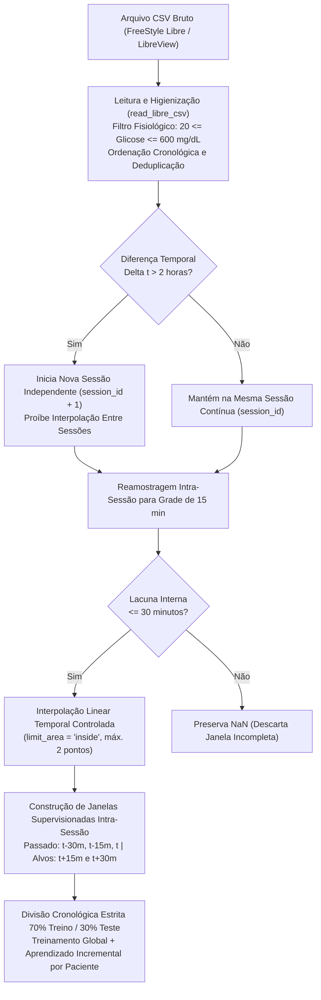
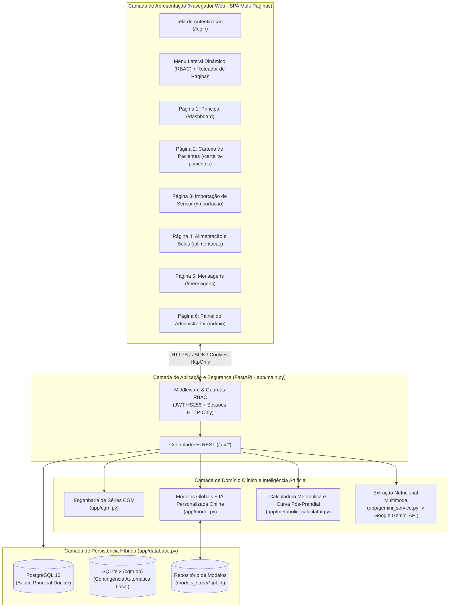
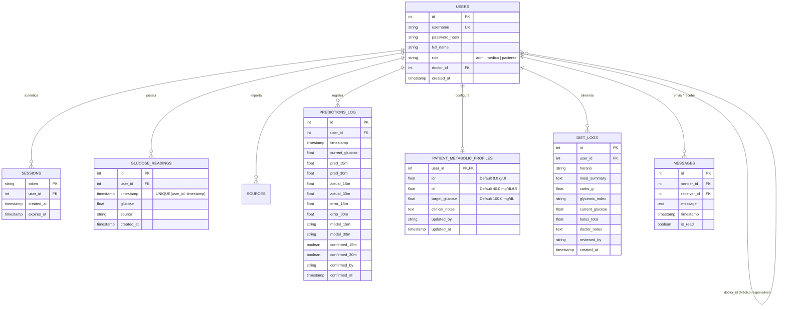
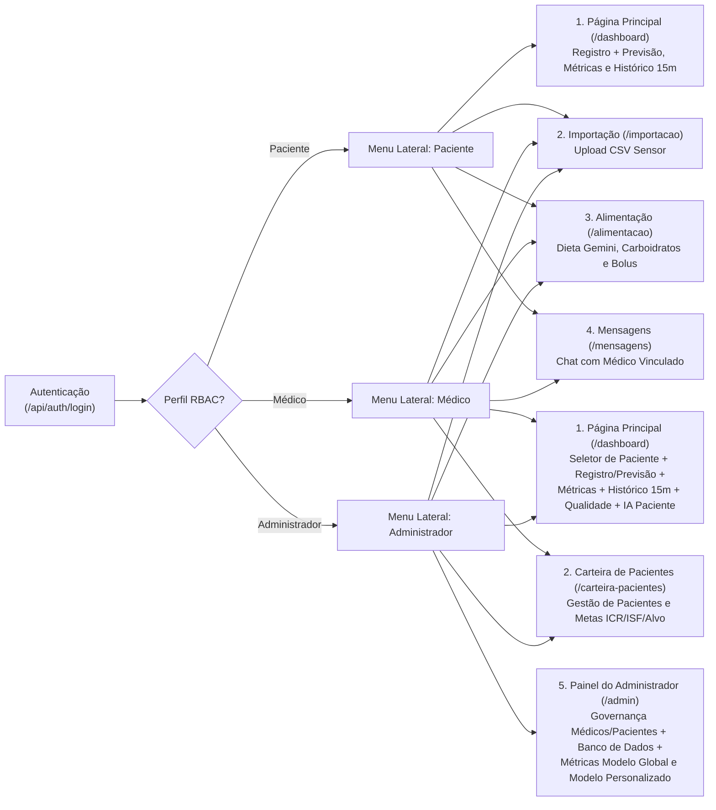

# [NOME DA INSTITUIÇÃO DE ENSINO SUPERIOR]
## [FACULDADE / CENTRO DE TECNOLOGIA E CIÊNCIAS EXATAS]
### [CURSO DE GRADUAÇÃO EM CIÊNCIA DA COMPUTAÇÃO / ENGENHARIA DE SOFTWARE / SISTEMAS DE INFORMAÇÃO]

---

**PAOLA [SOBRENOME DO(A) AUTOR(A)]**

# SISTEMA WEB INTELIGENTE PARA MONITORAMENTO CONTÍNUO DE GLICOSE (CGM), PREDIÇÃO GLICÊMICA DE CURTO PRAZO E APOIO METABÓLICO MULTIMODAL COM CONTROLE DE ACESSO BASEADO EM PAPÉIS

Trabalho de Conclusão de Curso apresentado ao Curso de Graduação em [Nome do Curso] da [Nome da Instituição de Ensino], como requisito parcial para a obtenção do título de Bacharel em [Nome do Curso].

**Orientador(a):** Prof.(a) Dr.(a) / Me.(a) [Nome do(a) Orientador(a)]

**[CIDADE – UF]**  
**2026**

---

## RESUMO

O Diabetes Mellitus constitui uma síndrome metabólica crônica de elevada prevalência mundial, cujo manejo clínico depende da manutenção estrita da glicemia dentro da faixa euglicêmica para mitigar complicações micro e macrovasculares, bem como episódios agudos de hipoglicemia e cetoacidose. O advento dos dispositivos de Monitoramento Contínuo de Glicose (*Continuous Glucose Monitoring* — CGM), como o sistema FreeStyle Libre, revolucionou o acompanhamento terapêutico ao fornecer séries temporais de glicose intersticial a cada 15 minutos. Todavia, a análise computacional dessas séries apresenta desafios metodológicos expressivos decorrentes de interrupções no uso do sensor, além da complexidade cognitiva exigida do paciente para contabilizar carboidratos e calcular doses prandiais e corretivas de insulina. Este Trabalho de Conclusão de Curso apresenta a fundamentação teórica, o projeto arquitetural, a implementação e a validação empírica de uma plataforma web completa em Python e FastAPI para análise clínica de sinais de CGM, predição glicêmica nos horizontes de $+15$ e $+30\text{ minutos}$, cálculo metabólico de bolus de insulina, estimativa nutricional multimodal assistida por Inteligência Artificial Generativa (Google Gemini) e telemonitoramento multiprofissional com Controle de Acesso Baseado em Papéis (*Role-Based Access Control* — RBAC). Metodologicamente, o pipeline desenvolvido corrige falhas clássicas de vazamento temporal (*data leakage*) ao segmentar automaticamente a série histórica em sessões independentes sempre que ocorrem lacunas superiores a 2 horas, aplicando reamostragem para grade regular de 15 minutos exclusivamente intra-sessão, interpolação linear restrita a hiatos internos de até 30 minutos e validação com divisão cronológica estrita 70/30. Além de três modelos globais supervisionados (Regressão Linear, *Random Forest* e *Gradient Boosting* com perda de Huber), implementou-se um motor de aprendizado incremental contínuo por paciente (`SGDRegressor` acoplado a *Gradient Boosting* residual sobre 12 atributos circadianos e metabólicos). Na avaliação experimental sobre um conjunto de dados real composto por $19.120$ leituras válidas distribuídas em $27$ sessões ($200,61$ dias ativos ao longo de $646$ dias de calendário, com cobertura ponderada intra-sessão de $98,92\%$), o modelo global obteve Erro Médio Absoluto ($\text{MAE}$) de $6,93\text{ mg/dL}$ ($\text{RMSE} = 10,33\text{ mg/dL}$; $R^2 = 0,9774$) para $+15\text{ minutos}$ e $\text{MAE} = 14,14\text{ mg/dL}$ ($\text{RMSE} = 20,30\text{ mg/dL}$; $R^2 = 0,9126$) para $+30\text{ minutos}$. A personalização contínua por paciente reduziu adicionalmente o erro local no horizonte de $+30\text{ minutos}$ para $\text{MAE} = 13,28\text{ mg/dL}$ e $\text{RMSE} = 17,93\text{ mg/dL}$. A interface foi estruturada em páginas independentes por perfil (`paciente`, `medico` e `adm`) com persistência híbrida PostgreSQL/SQLite, demonstrando viabilidade técnica e aderência às diretrizes clínicas nacionais e internacionais.

**Palavras-chave:** Monitoramento Contínuo de Glicose. Aprendizado de Máquina. Predição Glicêmica. Aprendizado Contínuo. Controle de Acesso Baseado em Papéis. Inteligência Artificial Generativa.

---

## ABSTRACT

Diabetes Mellitus is a highly prevalent chronic metabolic syndrome whose clinical management relies on maintaining blood glucose within the euglycemic range to prevent micro- and macrovascular complications as well as acute hypoglycemic and hyperglycemic events. Continuous Glucose Monitoring (CGM) devices, such as the FreeStyle Libre system, have transformed diabetes care by capturing interstitial glucose time series every 15 minutes. However, computational modeling of raw CGM exports faces major methodological challenges caused by inter-sensor gaps, alongside the daily cognitive burden placed on patients to estimate meal carbohydrates and compute prandial and corrective insulin boluses. This undergraduate thesis presents the theoretical foundation, architectural design, implementation, and empirical validation of a full-stack web platform built with Python and FastAPI for clinical CGM time-series analysis, short-term glucose forecasting (+15 and +30 minutes), metabolic insulin bolus calculation, multimodal nutritional estimation powered by Generative Artificial Intelligence (Google Gemini), and multi-professional telemonitoring governed by Role-Based Access Control (RBAC). Methodologically, the proposed pipeline eliminates temporal data leakage by automatically segmenting the time series into independent sensor sessions whenever gaps exceed 2 hours, resampling onto a 15-minute grid strictly within each session, restricting linear interpolation to internal gaps of up to 30 minutes, and evaluating models via a strict 70/30 chronological split. Alongside three global supervised models (Linear Regression, Random Forest, and Huber-loss Gradient Boosting), a patient-specific continuous online learning engine (`SGDRegressor` combined with residual Gradient Boosting across 12 circadian and metabolic features) was implemented. Empirical evaluation on a real-world dataset comprising $19,120$ valid readings across $27$ sensor sessions ($200.61$ active sensor days over a $646$-day span, with $98.92\%$ weighted intra-session coverage) yielded a global Mean Absolute Error ($\text{MAE}$) of $6.93\text{ mg/dL}$ ($\text{RMSE} = 10.33\text{ mg/dL}$; $R^2 = 0.9774$) at $+15\text{ minutes}$ and $\text{MAE} = 14.14\text{ mg/dL}$ ($\text{RMSE} = 20.30\text{ mg/dL}$; $R^2 = 0.9126$) at $+30\text{ minutes}$. Patient-specific continuous personalization further reduced the $+30\text{-minute}$ local error to $\text{MAE} = 13.28\text{ mg/dL}$ and $\text{RMSE} = 17.93\text{ mg/dL}$. The user interface is organized into role-isolated pages (`paciente`, `medico`, and `adm`) backed by a hybrid PostgreSQL/SQLite persistence layer, demonstrating robustness and alignment with clinical consensus.

**Keywords:** Continuous Glucose Monitoring. Machine Learning. Glucose Prediction. Continuous Learning. Role-Based Access Control. Generative Artificial Intelligence.

---

## LISTA DE ILUSTRAÇÕES

- **Figura 1** — Arquitetura em camadas do sistema web de monitoramento e predição glicêmica CGM v3
- **Figura 2** — Fluxograma metodológico do pipeline de segmentação de sessões, pré-processamento e engenharia de atributos sem vazamento temporal
- **Figura 3** — Diagrama Entidade-Relacionamento (DER) do banco de dados multi-usuário com suporte híbrido PostgreSQL e SQLite
- **Figura 4** — Topologia de navegação e isolamento de páginas por perfil de acesso (RBAC)

---

## LISTA DE TABELAS E QUADROS

- **Quadro 1** — Metas clínicas nacionais e internacionais para métricas de Monitoramento Contínuo de Glicose em adultos
- **Quadro 2** — Matriz de permissões e separação de páginas por perfil de usuário (RBAC)
- **Tabela 1** — Caracterização das sessões de monitoramento contínuo segmentadas (amostra representativa e consolidado das 27 sessões)
- **Tabela 2** — Indicadores de qualidade e cobertura da série temporal de glicose ($N = 19.120$)
- **Tabela 3** — Estatísticas descritivas e métricas clínicas padronizadas obtidas no conjunto de dados real
- **Tabela 4** — Desempenho comparativo dos modelos preditivos globais nos horizontes de $+15\text{ min}$ e $+30\text{ min}$ (divisão cronológica 70/30, $N = 19.738$ janelas)
- **Tabela 5** — Comparação empírica entre o Modelo Base Global e o Modelo Personalizado do Paciente (aprendizado contínuo)
- **Quadro 3** — Mapeamento completo dos endpoints REST e rotas de páginas do sistema revisado (Apêndice B)

---

## LISTA DE ABREVIATURAS E SIGLAS

- **ABNT** — Associação Brasileira de Normas Técnicas
- **ADA** — *American Diabetes Association* (Associação Americana de Diabetes)
- **ADM** — Administrador do Sistema
- **AGP** — *Ambulatory Glucose Profile* (Perfil Glicêmico Ambulatorial)
- **API** — *Application Programming Interface* (Interface de Programação de Aplicações)
- **ATTD** — *Advanced Technologies & Treatments for Diabetes*
- **BVS** — Biblioteca Virtual em Saúde (Ministério da Saúde)
- **CERT.br** — Centro de Estudos, Resposta e Tratamento de Incidentes de Segurança no Brasil
- **CGM** — *Continuous Glucose Monitoring* (Monitoramento Contínuo de Glicose)
- **CHO** — Carboidratos
- **CV** — Coeficiente de Variação Glicêmica
- **DM** — Diabetes Mellitus
- **DM1** — Diabetes Mellitus Tipo 1
- **DM2** — Diabetes Mellitus Tipo 2
- **ESD28** — Estratégia de Saúde Digital para o Brasil 2020–2028
- **GMI** — *Glucose Management Indicator* (Indicador de Gerenciamento de Glicose)
- **HbA1c** — Hemoglobina Glicada
- **HMAC** — *Hash-based Message Authentication Code*
- **ICR** — *Insulin-to-Carbohydrate Ratio* (Razão Insulina/Carboidrato)
- **IG** — Índice Glicêmico
- **ISF** — *Insulin Sensitivity Factor* (Fator de Sensibilidade à Insulina)
- **JSON** — *JavaScript Object Notation*
- **JWT** — *JSON Web Token*
- **LGPD** — Lei Geral de Proteção de Dados Pessoais (Lei nº 13.709/2018)
- **LLM** — *Large Language Model* (Grande Modelo de Linguagem)
- **MAE** — *Mean Absolute Error* (Erro Médio Absoluto)
- **MS** — Ministério da Saúde
- **NIST** — *National Institute of Standards and Technology*
- **OMS** — Organização Mundial da Saúde
- **OPAS** — Organização Pan-Americana da Saúde
- **PBKDF2** — *Password-Based Key Derivation Function 2*
- **RBAC** — *Role-Based Access Control* (Controle de Acesso Baseado em Papéis)
- **REST** — *Representational State Transfer*
- **RMSE** — *Root Mean Squared Error* (Raiz do Erro Quadrático Médio)
- **RoC** — *Rate of Change* (Taxa de Variação Glicêmica)
- **SBC** — Sociedade Brasileira de Computação
- **SBD** — Sociedade Brasileira de Diabetes
- **SGD** — *Stochastic Gradient Descent* (Gradiente Descendente Estocástico)
- **SPA** — *Single-Page Application*
- **SQL** — *Structured Query Language*
- **SUS** — Sistema Único de Saúde
- **TAR** — *Time Above Range* (Tempo Acima do Alvo: $> 180\text{ mg/dL}$)
- **TBR** — *Time Below Range* (Tempo Abaixo do Alvo: $< 70\text{ mg/dL}$)
- **TIR** — *Time in Range* (Tempo no Alvo: $70\text{–}180\text{ mg/dL}$)
- **UI** — Unidades Internacionais de Insulina

---

## SUMÁRIO

- **1 INTRODUÇÃO**
  - 1.1 Contextualização e Cenário Epidemiológico
  - 1.2 Problematização
  - 1.3 Hipóteses de Pesquisa
  - 1.4 Objetivos (Geral e Específicos)
  - 1.5 Justificativa e Relevância Científica e Social
  - 1.6 Delimitação do Escopo e Declaração Ética
  - 1.7 Organização do Trabalho
- **2 FUNDAMENTAÇÃO TEÓRICA**
  - 2.1 Fisiopatologia do Diabetes Mellitus e Homeostase Glicêmica
  - 2.2 Monitoramento Contínuo de Glicose (CGM) e Dinâmica do Fluido Intersticial
  - 2.3 Consenso de Métricas Clínicas (TIR, TAR, TBR, CV e GMI)
  - 2.4 Insulinoterapia Basal-Bolus, Contagem de Carboidratos e Modelagem Pós-Prandial
  - 2.5 Aprendizado de Máquina Supervisionado e Previsão de Séries Temporais Glicêmicas
  - 2.6 Inteligência Artificial Generativa Multimodal e Extração Estruturada na Nutrição Clínica
  - 2.7 Saúde Digital, Controle de Acesso (RBAC), Segurança de Autenticação e LGPD
  - 2.8 Trabalhos Correlatos na Literatura Nacional e Internacional
- **3 METODOLOGIA E ENGENHARIA DE DADOS**
  - 3.1 Caracterização Metodológica da Pesquisa
  - 3.2 Ingestão e Higienização Determinística de Arquivos do Sensor FreeStyle Libre
  - 3.3 Segmentação Automática de Sessões, Reamostragem e Interpolação Controlada
  - 3.4 Construção do Conjunto Supervisionado e Prevenção de Vazamento Temporal
  - 3.5 Engenharia de Atributos: Espaço Global (6 Variáveis) e Espaço Enriquecido (12 Variáveis)
  - 3.6 Treinamento dos Modelos Globais e Motor de Aprendizado Incremental Contínuo
- **4 ARQUITETURA E DESENVOLVIMENTO DO SISTEMA**
  - 4.1 Visão Geral da Arquitetura em Camadas e Conteinerização Docker
  - 4.2 Camada de Persistência Híbrida (PostgreSQL e Contingência Automática SQLite)
  - 4.3 Segurança Criptográfica, Sessões HTTP-Only e Governança Multi-Perfil (RBAC)
  - 4.4 Separação Modular por Páginas e Fluxo de Experiência do Usuário
  - 4.5 Módulo de Análise Nutricional Multimodal com Google Gemini e Calculadora de Bolus
- **5 RESULTADOS EXPERIMENTAIS E DISCUSSÃO**
  - 5.1 Qualidade dos Dados e Caracterização das 27 Sessões do Sensor
  - 5.2 Avaliação Clínica e Perfil Glicêmico da Série Histórica Real
  - 5.3 Desempenho Preditivo dos Modelos Globais (+15 min e +30 min)
  - 5.4 Impacto do Aprendizado Contínuo e Personalização Individual por Paciente
  - 5.5 Validação Funcional Integrada dos Módulos da Plataforma
- **6 CONCLUSÃO E TRABALHOS FUTUROS**
  - 6.1 Conclusões
  - 6.2 Limitações do Estudo
  - 6.3 Recomendações para Trabalhos Futuros
- **REFERÊNCIAS**
- **APÊNDICE A — DIRETRIZES DE FORMATAÇÃO EDITORIAL SEGUNDO AS NORMAS ABNT (GOOGLE DOCS / WORD)**
- **APÊNDICE B — INVENTÁRIO TÉCNICO DO CÓDIGO-FONTE E ENDPOINTS DA API**

---

# 1 INTRODUÇÃO

## 1.1 Contextualização e Cenário Epidemiológico

O Diabetes Mellitus (DM) configura um grupo heterogêneo de distúrbios metabólicos caracterizados pela presença de hiperglicemia persistente, resultante de defeitos na secreção de insulina pelas células beta ($\beta$) das ilhotas pancreáticas de Langerhans, na ação periférica desse hormônio nos tecidos-alvo ou em ambos os mecanismos combinados (Gross et al., 2002; Brasil, 2013; Sociedade Brasileira de Diabetes [SBD], 2024; American Diabetes Association [ADA], 2024). Segundo o *Relatório Mundial sobre o Diabetes* traduzido oficialmente pela Organização Pan-Americana da Saúde e Organização Mundial da Saúde (OMS; OPAS, 2016) e as diretrizes da SBD (2024), a doença atingiu proporções epidêmicas globais, posicionando o Brasil entre os países com maior número absoluto de adultos diagnosticados no mundo e impondo expressiva sobrecarga clínica e orçamentária ao Sistema Único de Saúde (SUS) e à saúde suplementar.

A relevância clínica do controle glicêmico intensivo reside no fato de que a exposição crônica à hiperglicemia desencadeia estresse oxidativo, glicação não enzimática de proteínas e disfunção endotelial, culminando em complicações microvasculares — retinopatia, nefropatia e neuropatia diabética — e macrovasculares, como infarto agudo do miocárdio e acidente vascular encefálico (Brasil, 2013; Golbert et al., 2020; Almeida-Pititto et al., 2026). Em contrapartida, a busca pelo controle estrito esbarra na barreira fisiológica da hipoglicemia iatrogênica ($< 70\text{ mg/dL}$ e, em estágio clinicamente crítico, $< 54\text{ mg/dL}$), que pode precipitar sintomas neuroglicopênicos graves, arritmias cardíacas, convulsões e coma caso não seja detectada e revertida precocemente (Puñales et al., 2008; SBD, 2024; Almeida-Pititto et al., 2026).

Historicamente, a monitorização terapêutica apoiou-se na dosagem laboratorial da Hemoglobina Glicada (HbA1c) e na automonitorização da glicemia capilar por punção digital. Conforme demonstrado na literatura endocrinológica brasileira por Oliveira et al. (2005) e Puñales et al. (2008), embora a HbA1c permaneça como um marcador relevante de risco crônico, ela reflete apenas a média ponderada da glicemia nos últimos dois a três meses, sendo incapaz de revelar a variabilidade glicêmica intradiária, as excursões pós-prandiais agudas e os episódios silenciosos de hipoglicemia noturna (Bergenstal et al., 2018; Battelino et al., 2019; Golbert et al., 2020). A introdução dos sistemas de Monitoramento Contínuo de Glicose (*Continuous Glucose Monitoring* — CGM), como o sensor FreeStyle Libre, superou essa limitação ao registrar leituras da glicose no líquido intersticial em intervalos regulares de 15 minutos, gerando até 96 medições diárias (Battelino et al., 2019; SBD, 2024).

## 1.2 Problematização

Apesar do volume de dados gerado pelos sensores CGM, a transformação dessas séries temporais brutas em suporte preditivo e clínico confiável enfrenta quatro obstáculos técnicos e metodológicos centrais:

1. **Descontinuidade estrutural e risco de vazamento temporal (*data leakage*)**: na vida real, o paciente não utiliza o sensor de forma ininterrupta ao longo de anos; ocorrem pausas de horas, dias ou meses entre a expiração de um sensor (tipicamente de 14 dias) e a inserção de outro. Quando algoritmos computacionais interpolam linearmente toda a série bruta sem antes isolar cada sessão de uso, fabricam-se milhares de pontos artificiais que distorcem a variabilidade clínica (Oliveira et al., 2005; Golbert et al., 2020). Adicionalmente, o emprego de divisões aleatórias entre treino e teste (*random split*) em janelas deslizantes sobrepostas provoca vazamento temporal de informação futura para o passado, inflando artificialmente as métricas de aprendizado de máquina (Pedregosa et al., 2011; Olivera et al., 2017; SBC, 2024);
2. **Heterogeneidade fisiológica inter-individual**: modelos preditivos treinados exclusivamente sobre uma base populacional global capturam a tendência média de inércia glicêmica, mas não se adaptam às particularidades circadianas, à sensibilidade insulínica e ao padrão alimentar de cada indivíduo ao longo do tempo (SBC, 2024; Almeida-Pititto et al., 2026);
3. **Complexidade da contagem de carboidratos e cálculo de bolus**: o cálculo diário da dose de insulina rápida exige estimar os gramas de carboidratos da refeição e aplicar equações metabólicas baseadas na Razão Insulina/Carboidrato (ICR) e no Fator de Sensibilidade à Insulina (ISF), tarefa sujeita a erros humanos frequentes (Walsh; Roberts; Bailey, 2011; SBD, 2016);
4. **Ausência de governança clínica multi-perfil integrada**: ferramentas analíticas acadêmicas frequentemente carecem de separação arquitetural de acesso entre o **Paciente** (que necessita de uma visualização clara e direta para autocuidado), o **Médico** (que gerencia uma carteira de múltiplos pacientes, prescreve parâmetros metabólicos e revisa dietas) e o **Administrador** (responsável pela governança de infraestrutura, banco de dados e auditoria dos modelos de Inteligência Artificial) (Ferraiolo et al., 2001; Brasil, 2018, 2020; CERT.br, 2024).

Diante desse cenário, formula-se a seguinte questão norteadora de pesquisa: **Como projetar e validar uma plataforma web segura e multi-perfil que processe séries temporais descontínuas do sensor FreeStyle Libre sem vazamento temporal, forneça predições glicêmicas acuradas de curto prazo (+15 e +30 minutos) combinando aprendizado global e personalização contínua por paciente, e integre apoio nutricional multimodal e cálculo metabólico de bolus?**

## 1.3 Hipóteses de Pesquisa

- **Hipótese Principal ($H_1$)**: A segmentação prévia da série temporal em sessões contínuas (separadas por hiatos $> 2\text{ horas}$), aliada à engenharia de atributos autorregressivos e de taxa de variação (*Rate of Change* — RoC) sob divisão cronológica estrita, permite prever a glicose intersticial em $+15$ e $+30\text{ minutos}$ com Erro Médio Absoluto ($\text{MAE}$) inferior a $15\text{ mg/dL}$ e coeficiente de determinação $R^2 > 0,90$.
- **Hipótese Secundária ($H_2$)**: A incorporação de um mecanismo híbrido de aprendizado incremental contínuo por paciente (*online learning* via `SGDRegressor` combinado a *Gradient Boosting* residual sobre variáveis circadianas e metabólicas locais) reduz o erro residual individual em comparação à inferência estática do modelo global isolado.

## 1.4 Objetivos

### 1.4.1 Objetivo Geral

Projetar, implementar e validar experimentalmente um sistema web inteligente e multi-usuário para análise clínica de dados de Monitoramento Contínuo de Glicose (CGM), predição glicêmica de curto prazo ($+15$ e $+30\text{ minutos}$) com aprendizado contínuo personalizado por paciente e suporte metabólico e nutricional multimodal sob Controle de Acesso Baseado em Papéis (RBAC).

### 1.4.2 Objetivos Específicos

1. Desenvolver um pipeline determinístico de engenharia de dados ([`app/cgm.py`](file:///c:/Users/paola/Desktop/tcc%20test/tcc_cgm_app_v3/tcc_cgm_app_v3/app/cgm.py)) capaz de ingerir exportações CSV do FreeStyle Libre, filtrar artefatos fisiológicos fora da faixa $[20, 600]\text{ mg/dL}$, segmentar sessões independentes (lacunas $> 2\text{ horas}$), reamostrar intra-sessão em intervalos de 15 minutos e restringir a interpolação linear a buracos internos de no máximo 30 minutos;
2. Implementar a extração automatizada das métricas clínicas padronizadas pelas diretrizes da SBD e pelo consenso internacional de CGM (Média, Mediana, Desvio-Padrão, Coeficiente de Variação — CV, Tempo no Alvo — TIR, Tempo Acima do Alvo — TAR, Tempo Abaixo do Alvo — TBR e Indicador de Gerenciamento de Glicose — GMI) e o mapa diário em intervalos de 15 minutos;
3. Construir, treinar e avaliar comparativamente três algoritmos supervisionados globais — Regressão Linear, *Random Forest* e *Gradient Boosting* com perda de Huber ([`app/model.py`](file:///c:/Users/paola/Desktop/tcc%20test/tcc_cgm_app_v3/tcc_cgm_app_v3/app/model.py)) — utilizando janelas estritamente intra-sessão e partição cronológica 70/30;
4. Projetar um motor de personalização individual por paciente com aprendizado incremental contínuo (`SGDRegressor` via `partial_fit` e *Gradient Boosting* local sobre 12 atributos enriquecidos), retroalimentado a cada nova leitura manual ou confirmação clínica de exatidão;
5. Integrar um módulo de análise nutricional multimodal via API Google Gemini ([`app/gemini_service.py`](file:///c:/Users/paola/Desktop/tcc%20test/tcc_cgm_app_v3/tcc_cgm_app_v3/app/gemini_service.py)) com validação estruturada `Pydantic` e uma calculadora metabólica de bolus prandial/corretivo com simulação farmacodinâmica pós-prandial de 60 minutos ([`app/metabolic_calculator.py`](file:///c:/Users/paola/Desktop/tcc%20test/tcc_cgm_app_v3/tcc_cgm_app_v3/app/metabolic_calculator.py));
6. Arquitetar uma camada de persistência híbrida PostgreSQL/SQLite ([`app/database.py`](file:///c:/Users/paola/Desktop/tcc%20test/tcc_cgm_app_v3/tcc_cgm_app_v3/app/database.py)) e uma interface web responsiva dividida em páginas independentes por perfil RBAC (`paciente`, `medico` e `adm`) ([`templates/index.html`](file:///c:/Users/paola/Desktop/tcc%20test/tcc_cgm_app_v3/tcc_cgm_app_v3/templates/index.html)).

## 1.5 Justificativa e Relevância Científica e Social

Sob a ótica clínica e social, ferramentas computacionais que auxiliam a interpretação de dados de CGM, antecipam tendências de hipoglicemia ou hiperglicemia em 15 a 30 minutos e automatizam a contagem de carboidratos alinham-se diretamente à *Estratégia de Saúde Digital para o Brasil 2020–2028 (ESD28)* do Ministério da Saúde (Brasil, 2020) e às recomendações da Sociedade Brasileira de Diabetes (SBD, 2016, 2024), reduzindo a sobrecarga diária de decisões enfrentada por pessoas com diabetes e por equipes médicas. Sob a ótica da Ciência da Computação, o trabalho oferece uma contribuição metodológica rigorosa ao demonstrar como evitar armadilhas recorrentes em séries temporais biomédicas — tais como a interpolação indevida entre sessões desconexas e o vazamento de dados em validação cruzada aleatória (SBC, 2024) —, além de apresentar uma arquitetura *full-stack* resiliente com *fallback* automático de banco de dados e contingência para serviços de IA em nuvem (FastAPI, 2025; Google, 2025).

## 1.6 Delimitação do Escopo e Declaração Ética

O sistema desenvolvido caracteriza-se estritamente como um **protótipo acadêmico e experimental de apoio à visualização e decisão clínica**, não substituindo o julgamento médico presencial, a aferição por glicemia capilar em situações de discrepância sintomática nem exames laboratoriais diagnósticos. Os dados sintéticos gerados pelo módulo auxiliar de simulação ([`app/synthetic.py`](file:///c:/Users/paola/Desktop/tcc%20test/tcc_cgm_app_v3/tcc_cgm_app_v3/app/synthetic.py)) são explicitamente rotulados e segregados dos dados reais de sensores. Todo o tratamento de informações observa os princípios de finalidade, necessidade, segurança e controle de acesso preconizados pela Lei Geral de Proteção de Dados Pessoais — LGPD (Brasil, 2018).

## 1.7 Organização do Trabalho

Além deste capítulo introdutório, o documento estrutura-se em mais cinco capítulos: o **Capítulo 2** desenvolve a Fundamentação Teórica e a revisão do estado da arte com referenciação segundo as normas da ABNT; o **Capítulo 3** detalha a Metodologia Científica e a Engenharia de Dados e Modelos; o **Capítulo 4** descreve a Arquitetura de Software, o Banco de Dados Híbrido, o controle RBAC e a separação da interface em páginas; o **Capítulo 5** apresenta e discute os Resultados Experimentais obtidos sobre a série histórica real de $19.120$ leituras; e o **Capítulo 6** sintetiza as Conclusões, Limitações e Trabalhos Futuros, seguido das **Referências** (todas com URLs verificáveis na internet) e dos **Apêndices**.

---

# 2 FUNDAMENTAÇÃO TEÓRICA

## 2.1 Fisiopatologia do Diabetes Mellitus e Homeostase Glicêmica

Em condições fisiológicas normais, a concentração plasmática de glicose é mantida dentro de limites estreitos (tipicamente entre $70$ e $100\text{ mg/dL}$ em jejum e inferior a $140\text{ mg/dL}$ no período pós-prandial) por meio de um sistema neuroendócrino de retroalimentação negativa que equilibra a produção hepática de glicose (glicogenólise e gliconeogênese), a absorção intestinal de carboidratos e a captação periférica pelos tecidos muscular e adiposo (Gross et al., 2002; Brasil, 2013). A insulina, secretada pelas células $\beta$ pancreáticas em padrão bifásico (basal contínuo e pulsos prandiais), atua como o principal hormônio anabólico hipoglicemiante, enquanto o glucagon, a epinefrina, o cortisol e o hormônio do crescimento constituem os hormônios contrarreguladores hiperglicemiantes (Brasil, 2013; ADA, 2024; SBD, 2024).

No Diabetes Mellitus Tipo 1 (DM1), a destruição autoimune progressiva das células $\beta$ acarreta deficiência absoluta de insulina endógena, tornando o indivíduo dependente da insulinoterapia exógena para a sobrevivência e altamente suscetível a oscilações glicêmicas abruptas (Brasil, 2013; Puñales et al., 2008; SBD, 2024). No Diabetes Mellitus Tipo 2 (DM2), coexistem graus variáveis de resistência periférica à ação da insulina e disfunção secretória progressiva das células $\beta$, podendo evoluir para a necessidade de reposição insulínica plena (Gross et al., 2002; OMS; OPAS, 2016; SBD, 2024). Conforme estabelecem os *Cadernos de Atenção Básica* do Ministério da Saúde sobre o cuidado da pessoa com Diabetes Mellitus:

> O diabetes apresenta alta morbimortalidade, com perda importante na qualidade de vida. É uma das principais causas de mortalidade, insuficiência renal, amputação de membros inferiores, cegueira e doença cardiovascular. [...] O controle glicêmico adequado reduz significativamente o surgimento e a progressão das complicações micro e macrovasculares (Brasil, 2013, p. 19).

Todavia, a busca intensiva pela normoglicemia esbarra no fenômeno da hipoglicemia, que constitui o principal fator limitante no manejo farmacológico do diabetes (Puñales et al., 2008; Brasil, 2013; Almeida-Pititto et al., 2026). Episódios recorrentes de queda glicêmica atenuam a resposta autonômica adrenérgica de alerta, quadro conhecido como hipoglicemia despercebida, elevando substancialmente o risco de eventos severos Noturnos e reforçando a necessidade de sistemas preditivos capazes de antecipar tendências de queda antes que o limiar crítico seja atingido (Oliveira et al., 2005; Puñales et al., 2008; SBD, 2024).

## 2.2 Monitoramento Contínuo de Glicose (CGM) e Dinâmica do Fluido Intersticial

Os sensores de Monitoramento Contínuo de Glicose (*Continuous Glucose Monitoring* — CGM), incluindo os sistemas de varredura intermitente (*intermittently scanned CGM* — isCGM / *flash*) e os sistemas em tempo real (*real-time CGM* — rtCGM), mensuram a concentração de glicose no fluido intersticial subcutâneo por meio de uma reação eletroquímica catalisada pela enzima glicose oxidase imobilizada em um filamento flexível inserido sob a pele (Oliveira et al., 2005; Puñales et al., 2008; Battelino et al., 2019; Golbert et al., 2020).

Do ponto de vista biofísico e compartimental, conforme analisado nos *Arquivos Brasileiros de Endocrinologia & Metabologia* por Oliveira et al. (2005) e Puñales et al. (2008), a glicose difunde-se passivamente do leito capilar sanguíneo através do endotélio para o compartimento intersticial de acordo com o gradiente de concentração e o fluxo sanguíneo tecidual local. Esse transporte transcapilar introduz um atraso fisiológico e instrumental (*lag time*) estimado entre 5 e 15 minutos em relação à glicemia plasmática capilar, cuja dinâmica pode ser descrita por um modelo compartimental de primeira ordem (Equação 1):

$$\frac{dG_{i}(t)}{dt} = -\left(k_{02} + k_{12}\right) G_{i}(t) + k_{21} \frac{V_{p}}{V_{i}} G_{p}(t) \tag{1}$$

onde $G_{p}(t)$ e $G_{i}(t)$ representam as concentrações de glicose nos compartimentos plasmático e intersticial no instante $t$, $V_{p}$ e $V_{i}$ são os respectivos volumes de distribuição e $k_{21}, k_{12}, k_{02}$ são as constantes de taxa de transferência e captação celular.

A consequência clínica direta dessa cinética compartimental é que, durante períodos de rápida taxa de variação glicêmica (*Rate of Change* — RoC, como logo após a ingestão de carboidratos de rápida absorção ou durante exercício físico aeróbico), a leitura atual exibida pelo sensor pode subestimar uma subida aguda ou superestimar a glicemia real durante uma queda acelerada (Puñales et al., 2008; Battelino et al., 2019; SBD, 2024). Por conseguinte, algoritmos de Aprendizado de Máquina que incorporam explicitamente as defasagens temporais (*lags*) e a derivada temporal da glicose ($\text{RoC}$) atuam compensando matematicamente a inércia intersticial e antecipando a trajetória futura do paciente em horizontes de 15 a 30 minutos (SBC, 2024).

## 2.3 Consenso de Métricas Clínicas (TIR, TAR, TBR, CV e GMI)

Para padronizar a interpretação clínica dos relatórios de CGM e do Perfil Glicêmico Ambulatorial (*Ambulatory Glucose Profile* — AGP), o Consenso Internacional sobre Tempo no Alvo (*International Consensus on Time in Range*), liderado por Battelino et al. (2019) e integralmente adotado em língua portuguesa pelas Diretrizes Oficiais da Sociedade Brasileira de Diabetes (Golbert et al., 2020; SBD, 2024; Almeida-Pititto et al., 2026), estabeleceu um conjunto canônico de indicadores estatísticos calculados sobre séries com pelo menos 14 dias ativos e cobertura mínima de 70% dos dados. Conforme destacam Battelino et al. (2019, p. 1594, tradução nossa), "o uso eficaz de dados de CGM na prática clínica rotineira exige metas claras e clinicamente acionáveis que complementem a A1C e orientem o ajuste terapêutico seguro".

Seja $G = \{g_1, g_2, \dots, g_N\}$ o conjunto de $N$ leituras válidas de glicose intersticial (em $\text{mg/dL}$) de um paciente. As métricas clínicas fundamentais implementadas neste trabalho são definidas formalmente a seguir:

1. **Média Glicêmica ($\mu$) e Desvio-Padrão ($\sigma$)** (Equações 2 e 3):

$$\mu = \frac{1}{N}\sum_{i=1}^{N} g_i \tag{2}$$

$$\sigma = \sqrt{\frac{1}{N-1}\sum_{i=1}^{N} (g_i - \mu)^2} \tag{3}$$

2. **Coeficiente de Variação Glicêmica ($\text{CV}$)**: quantifica a amplitude da variabilidade glicêmica intradiária e interdiária normalizada pela média (Equação 4). De acordo com as Diretrizes da Sociedade Brasileira de Diabetes (Golbert et al., 2020; SBD, 2024; Almeida-Pititto et al., 2026), o limiar de $\text{CV} \le 36\%$ discrimina o diabetes estável do diabetes lábil (instável), sendo fortemente correlacionado à incidência de hipoglicemias:

$$\text{CV (\%)} = \left(\frac{\sigma}{\mu}\right) \times 100 \tag{4}$$

3. **Tempo no Alvo (*Time in Range* — $\text{TIR}$)**: proporção percentual de leituras contidas na faixa euglicêmica padrão $[70, 180]\text{ mg/dL}$ (Equação 5), validada como preditor independente de complicações microvasculares (Battelino et al., 2019; SBD, 2024; Almeida-Pititto et al., 2026):

$$\text{TIR (\%)} = \frac{1}{N}\sum_{i=1}^{N} \mathbb{I}(70 \le g_i \le 180) \times 100 \tag{5}$$

4. **Tempo Acima do Alvo (*Time Above Range* — $\text{TAR}$)** e **Tempo Abaixo do Alvo (*Time Below Range* — $\text{TBR}$)**: proporções percentuais de leituras em estado hiperglicêmico ($> 180\text{ mg/dL}$) e hipoglicêmico ($< 70\text{ mg/dL}$), respectivamente (Equações 6 e 7):

$$\text{TAR (\%)} = \frac{1}{N}\sum_{i=1}^{N} \mathbb{I}(g_i > 180) \times 100 \tag{6}$$

$$\text{TBR (\%)} = \frac{1}{N}\sum_{i=1}^{N} \mathbb{I}(g_i < 70) \times 100 \tag{7}$$

5. **Indicador de Gerenciamento de Glicose (*Glucose Management Indicator* — $\text{GMI}$)**: formulado e validado por Bergenstal et al. (2018) e incorporado às diretrizes brasileiras (Golbert et al., 2020; SBD, 2024) para substituir a antiga "HbA1c estimada (eA1C)", expressando o nível médio de exposição glicêmica em percentual equivalente (Equação 8):

$$\text{GMI (\%)} = 3,31 + 0,02392 \times \mu_{\text{mg/dL}} \tag{8}$$

O Quadro 1 sintetiza os valores de referência preconizados para pacientes adultos com DM1 e DM2 pela SBD (2024), Almeida-Pititto et al. (2026), ADA (2024) e Battelino et al. (2019).

**Quadro 1 — Metas clínicas nacionais e internacionais para métricas de Monitoramento Contínuo de Glicose em adultos**

| Indicador Clínico | Definição Operacional | Meta Clínica Padrão (DM1 / DM2) | Significado Clínico e Terapêutico |
| :--- | :--- | :---: | :--- |
| **Cobertura de Dados** | Leituras capturadas / Leituras esperadas | $\ge 70\%$ (em 14 dias) | Confiabilidade estatística da amostra do sensor |
| **TIR (*Time in Range*)** | $70 \le g_i \le 180\text{ mg/dL}$ | $> 70\%$ | Controle glicêmico adequado e proteção vascular |
| **TAR (*Time Above Range*)** | $g_i > 180\text{ mg/dL}$ (Níveis 1 e 2) | $< 25\%$ ($>250$: $<5\%$) | Prevenção de hiperglicemia e glicação proteica |
| **TBR (*Time Below Range*)** | $g_i < 70\text{ mg/dL}$ (Níveis 1 e 2) | $< 4\%$ ($<54$: $<1\%$) | Prioridade máxima: prevenção de hipoglicemia |
| **Coeficiente de Variação (CV)** | $(\sigma / \mu) \times 100$ | $\le 36\%$ | Estabilidade glicêmica (ausência de labilidade) |
| **GMI** | $3,31 + 0,02392 \times \mu$ | $< 7,0\%$ | Estimativa de exposição crônica equivalente à HbA1c |

**Fonte:** Adaptado de Battelino et al. (2019), Bergenstal et al. (2018), ADA (2024), SBD (2024) e Almeida-Pititto et al. (2026).

## 2.4 Insulinoterapia Basal-Bolus, Contagem de Carboidratos e Modelagem Pós-Prandial

A terapia insulínica intensiva fundamenta-se no esquema basal-bolus, que busca mimetizar a fisiologia pancreática por meio da administração de uma insulina basal de ação lenta ou ultralenta (para suprimir a produção hepática de glicose em jejum) combinada a doses de insulina rápida ou ultrarrápida (*bolus*) antes das refeições e para correção de hiperglicemias eventuais (Brasil, 2013; SBD, 2016, 2024).

De acordo com o *Manual Oficial de Contagem de Carboidratos para Pessoas com Diabetes* da Sociedade Brasileira de Diabetes (SBD, 2016), os carboidratos alimentares constituem o macronutriente de maior e mais imediato impacto sobre a glicemia pós-prandial, visto que praticamente 100% dos carboidratos digeríveis são convertidos em glicose na corrente sanguínea entre 15 minutos e 2 horas após a ingestão. Adicionalmente, a velocidade dessa excursão glicêmica é modulada pelo **Índice Glicêmico (IG)** da refeição — classificado em Baixo ($\text{IG} < 55$), Médio ($56 \le \text{IG} \le 69$) ou Alto ($\text{IG} \ge 70$) —, bem como pelo teor concomitante de fibras, proteínas e lipídios (SBD, 2016, 2024). Conforme enfatiza o manual clínico disponibilizado online pela SBD:

> A contagem de carboidratos é uma estratégia nutricional que tem sido amplamente utilizada no tratamento do diabetes mellitus há mais de duas décadas, permitindo maior flexibilidade nas escolhas alimentares e maior precisão no ajuste das doses de insulina prandial de acordo com a quantidade de carboidratos ingerida em cada refeição (SBD, 2016, p. 11).

Para determinar de forma objetiva a dose de insulina ultrarrápida a ser administrada antes de uma refeição, Walsh, Roberts e Bailey (2011) e a SBD (2016) formalizam o algoritmo matemático das calculadoras clínicas de bolus a partir de três parâmetros individuais prescritos pelo médico endocrinologista:
- **Razão Insulina/Carboidrato ($\text{ICR}$, em $\text{g/UI}$)**: quantidade em gramas de carboidrato coberta por $1\text{ UI}$ de insulina rápida;
- **Fator de Sensibilidade à Insulina ($\text{ISF}$, em $\text{mg/dL/UI}$)**: redução esperada na glicemia plasmática (em $\text{mg/dL}$) promovida por $1\text{ UI}$ de insulina rápida;
- **Glicemia Alvo ($G_{\text{alvo}}$, em $\text{mg/dL}$)**: concentração glicêmica normativa desejada para o paciente (tipicamente $100\text{ mg/dL}$).

O **Bolus Alimentar ($\text{Bolus}_{\text{CHO}}$)** e o **Bolus de Correção ($\text{Bolus}_{\text{Correção}}$)** são dados pelas Equações 9, 10 e 11 (Walsh; Roberts; Bailey, 2011; SBD, 2016):

$$\text{Bolus}_{\text{CHO}} = \frac{\text{CHO}_{\text{refeição (g)}}}{\text{ICR}} \tag{9}$$

$$\text{Bolus}_{\text{Correção}} = \max\!\left(0,\; \frac{G_{\text{atual}} - G_{\text{alvo}}}{\text{ISF}}\right) \tag{10}$$

$$\text{Bolus}_{\text{Total}} = \text{Bolus}_{\text{CHO}} + \text{Bolus}_{\text{Correção}} \tag{11}$$

Sob equivalência estequiométrica entre sensibilidade insulínica e cobertura prandial, cada grama de carboidrato ingerido sem cobertura insulínica provoca uma elevação teórica de $\Delta G_{\text{CHO}} = \text{ISF} / \text{ICR}\text{ (mg/dL/g)}$ (Walsh; Roberts; Bailey, 2011). Como a absorção enteral da glicose ocorre mais rapidamente nos primeiros 60 minutos do que o pico de ação farmacodinâmica da insulina subcutânea ultrarrápida (que se estende por 3 a 4 horas, com início em 15 minutos e pico entre 60 e 90 minutos), a modelagem da curva pós-prandial nos instantes $t \in \{0, 15, 30, 45, 60\}\text{ min}$ requer a ponderação entre a fração de absorção entérica modulada pelo Índice Glicêmico e a fração de ativação insulínica inicial (SBD, 2016, 2024).

## 2.5 Aprendizado de Máquina Supervisionado e Previsão de Séries Temporais Glicêmicas

### 2.5.1 Formulação Autorregressiva de Séries Temporais e Vazamento Temporal (*Data Leakage*)

Na abordagem de Aprendizado de Máquina supervisionado aplicada a séries temporais clínicas (Pedregosa et al., 2011; Olivera et al., 2017; SBC, 2024), converte-se a sequência temporal ordenada $\{g_t\}_{t=1}^{T}$ em pares de entrada-saída $(\mathbf{x}_t, y_{t+h})$ por meio do método de janelas deslizantes (*sliding windows*) com variáveis defasadas (*lagged features*), onde $\mathbf{x}_t \in \mathbb{R}^p$ resume a história recente até o instante $t$ e $y_{t+h} = g_{t+h}$ representa o valor futuro no horizonte $h$.

Um erro metodológico grave na modelagem de séries temporais biomédicas consiste no **vazamento temporal de dados (*data leakage*)**, que ocorre quando informações posteriores ao instante de predição contaminam a etapa de treinamento ou quando janelas deslizantes adjacentes são sorteadas aleatoriamente entre os conjuntos de treino e teste (*random cross-validation*). Em séries de glicose amostradas a cada 15 minutos, a forte autocorrelação de primeira ordem faz com que a partição aleatória produza estimativas irreais de desempenho. Por essa razão, os estudos nacionais publicados no *Simpósio Brasileiro de Computação Aplicada à Saúde (SBCAS)* (SBC, 2024) determinam que a validação deve respeitar estritamente a ordem cronológica dos eventos, alocando os primeiros $(1 - \alpha) \times 100\%$ registros para treinamento e os $\alpha \times 100\%$ registros finais para teste fora da amostra (*out-of-time evaluation*).

### 2.5.2 Regressão Linear Múltipla, *Random Forest* e *Gradient Boosting* com Perda de Huber

A **Regressão Linear Múltipla** modela a variável resposta como uma combinação afim dos preditores $\hat{y}_t = \beta_0 + \mathbf{x}_t^\top \boldsymbol{\beta}$, estimando o vetor de parâmetros $\boldsymbol{\beta}$ pela minimização da soma dos quadrados dos resíduos (*Ordinary Least Squares* — OLS) (Equação 12) (Pedregosa et al., 2011):

$$\hat{\boldsymbol{\beta}} = \arg\min_{\boldsymbol{\beta}} \sum_{t=1}^{n} \left(y_t - \beta_0 - \mathbf{x}_t^\top \boldsymbol{\beta}\right)^2 \tag{12}$$

Em horizontes ultracurtos ($+15$ e $+30\text{ minutos}$), nos quais a trajetória glicêmica é fortemente governada pela inércia local e pela derivada de primeira ordem, o estimador linear oferece um *baseline* de baixa variância e elevada interpretabilidade analítica.

Para capturar interações não lineares e pontos de inflexão pós-prandiais, recorre-se a métodos de comitê (*ensemble learning*) baseados em árvores de decisão de regressão implementados no pacote `scikit-learn` (Pedregosa et al., 2011; Olivera et al., 2017):

1. ***Random Forest* (Florestas Aleatórias)**: proposto por Breiman (2001), constrói uma coleção de $B$ árvores de regressão $\{T_b(\mathbf{x})\}_{b=1}^{B}$ treinadas de forma independente sobre amostras *bootstrap* do conjunto de treinamento (*bagging*), selecionando em cada nó um subconjunto aleatório de atributos candidatos (Equação 13). Conforme demonstrado por Breiman (2001) e aplicado em coortes brasileiras por Olivera et al. (2017) e SBC (2024), a média das predições das árvores reduz drasticamente a variância do estimador sem aumentar o seu viés:

$$\hat{f}_{\text{RF}}(\mathbf{x}) = \frac{1}{B}\sum_{b=1}^{B} T_b(\mathbf{x}) \tag{13}$$

2. ***Gradient Boosting Regressor* com Perda Robusta de Huber**: introduzido por Friedman (2001), constrói um modelo aditivo sequencial $F_M(\mathbf{x}) = \sum_{m=1}^{M} \nu h_m(\mathbf{x})$, no qual cada nova árvore rasa $h_m$ é ajustada aos pseudo-resíduos (gradiente negativo da função de perda) do estágio anterior, ponderada por uma taxa de aprendizado $\nu \in (0, 1]$. Como séries de sensores CGM estão sujeitas a ruídos pontuais de compressão mecânica do filamento subcutâneo (*compression lows*) ou picos abruptos, substitui-se a perda quadrática tradicional pela **função de perda híbrida de Huber** (Friedman, 2001; Pedregosa et al., 2011), que se comporta de forma quadrática para erros pequenos ($|r| \le \delta$) e linear para *outliers* ($|r| > \delta$), evitando que artefatos isolados distorçam o gradiente das árvores (Equação 14):

$$L_{\delta}(y, \hat{y}) = \begin{cases} \frac{1}{2}(y - \hat{y})^2, & \text{se } |y - \hat{y}| \le \delta \\ \delta \left(|y - \hat{y}| - \frac{1}{2}\delta\right), & \text{se } |y - \hat{y}| > \delta \end{cases} \tag{14}$$

### 2.5.3 Aprendizado Incremental Contínuo (*Online Learning*) e Adaptação Residual por Paciente

Na aprendizagem de máquina aplicada à saúde, a distribuição conjunta $P(\mathbf{x}, y)$ da dinâmica glicêmica apresenta diferenças expressivas entre indivíduos devido a fatores como resistência periférica à insulina, horários habituais de alimentação e rotina de sono (Almeida-Pititto et al., 2026; SBC, 2024). Consequentemente, um modelo estático treinado sobre um *pool* populacional global tende a apresentar viés residual sistemático quando aplicado a um paciente específico.

Para solucionar esse problema sem exigir o retreinamento custoso do modelo global a cada nova medição, recorre-se ao paradigma de **Aprendizado Incremental Online (*Online Learning*)** via Gradiente Descendente Estocástico (*Stochastic Gradient Descent* — SGD) disponibilizado pela classe `SGDRegressor` do `scikit-learn` (Pedregosa et al., 2011). No esquema de aprendizagem residual adotado neste trabalho, o previsor personalizado aprende a estimar o resíduo individual $r_t = y_t - \hat{y}_{\text{global}}(\mathbf{x}_t)$ a partir de um vetor expandido de atributos específicos do paciente $\tilde{\mathbf{x}}_t \in \mathbb{R}^{12}$ (contendo fase circadiana trigonométrica, janela pós-prandial e relação $\text{ISF}/\text{ICR}$). A cada novo lote de observações recentes ou confirmações de exatidão validadas pelo usuário, os pesos $\mathbf{w}$ do modelo `SGDRegressor` são atualizados incrementalmente pela regra `partial_fit` com regularização $L_2$ (*Ridge*) e perda de Huber (Equação 15):

$$\mathbf{w}^{(k+1)} = \mathbf{w}^{(k)} - \eta_k \left( \omega_t \nabla_{\mathbf{w}} L_{\epsilon}\!\left(r_t,\; \mathbf{w}^{(k)\top}\tilde{\mathbf{x}}_t\right) + \alpha \mathbf{w}^{(k)} \right) \tag{15}$$

onde $\eta_k = \eta_0 / k^{p}$ é a taxa de aprendizado decrescente (*invscaling*), $\alpha > 0$ é o hiperparâmetro de penalização $L_2$ que impede a deriva abrupta de pesos (*catastrophic forgetting*) e $\omega_t$ é o peso de relevância amostral (superior para predições explicitamente confirmadas pelo paciente ou médico).

## 2.6 Inteligência Artificial Generativa Multimodal e Extração Estruturada na Nutrição Clínica

Os Grandes Modelos de Linguagem (*Large Language Models* — LLMs) evoluíram para arquiteturas nativamente multimodais, como a família **Google Gemini** (Google, 2025), capazes de processar simultaneamente texto livre, documentos PDF e imagens de refeições em um espaço semântico unificado.

Na prática nutricional do diabetes, um dos maiores entraves à adesão ao tratamento é a dificuldade do paciente em consultar tabelas nutricionais extensas para converter alimentos do cotidiano brasileiro em gramas de carboidratos disponíveis (SBD, 2016). Entretanto, o uso de modelos generativos em sistemas clínicos exige determinismo sintático: respostas textuais abertas não podem alimentar diretamente uma calculadora matemática de insulina sem risco de erros de *parsing*. De acordo com a documentação oficial em português da API Google Gemini (Google, 2025), esse problema é resolvido mediante o mecanismo de **Saídas Estruturadas (*Structured Outputs*)** baseadas em *JSON Schema* e modelos `Pydantic`, que restringem a decodificação de *tokens* do modelo para obedecer rigorosamente a uma gramática tipada pré-definida (`AnaliseDieta`, `Refeicao` e `OpcaoRefeicao`), garantindo integridade de tipos numéricos e classificações categóricas de Índice Glicêmico.

## 2.7 Saúde Digital, Controle de Acesso (RBAC), Segurança de Autenticação e LGPD

O desenvolvimento de plataformas computacionais de telemonitoramento médico insere-se nas diretrizes da **Estratégia de Saúde Digital para o Brasil 2020–2028 (ESD28)** do Ministério da Saúde (Brasil, 2020), que estabelece a interoperabilidade, a segurança da informação, a governança de acesso e o empoderamento do paciente como eixos prioritários da informática em saúde no país.

No que tange à segurança e governança de acesso em ambientes multi-usuário, o modelo canônico adotado pela indústria e formalizado pelo *National Institute of Standards and Technology* (NIST) é o **Controle de Acesso Baseado em Papéis (*Role-Based Access Control* — RBAC)**, proposto por Ferraiolo et al. (2001) e integrado às arquiteturas modernas de APIs web em Python documentadas oficialmente em português pelo *framework* FastAPI (FastAPI, 2025). No modelo RBAC, as permissões de execução de operações sobre objetos protegidos são associadas a papéis funcionais (*roles*) que refletem a estrutura organizacional do domínio:
- $U$: conjunto de usuários autenticados;
- $R = \{\texttt{paciente}, \texttt{medico}, \texttt{adm}\}$: conjunto de papéis clínicos e administrativos;
- $P$: conjunto de permissões sobre rotas de interface, endpoints REST e registros de banco de dados;
- $UA \subseteq U \times R$ e $PA \subseteq P \times R$: relações de atribuição usuário-papel e permissão-papel, acrescidas de restrições de escopo de dados (*row-level tenancy*), garantindo que um médico acesse exclusivamente os pacientes vinculados à sua carteira (`doctor_id`) e que um paciente acesse estritamente os seus próprios registros (`user_id`) (Ferraiolo et al., 2001; FastAPI, 2025).

No ordenamento jurídico brasileiro, a **Lei Geral de Proteção de Dados Pessoais — LGPD (Lei nº 13.709/2018)** classifica os dados referentes à saúde como **dados pessoais sensíveis** (art. 5º, inciso II), determinando em seu art. 46 que os agentes de tratamento adotem medidas técnicas e administrativas aptas a proteger os dados pessoais de acessos não autorizados (Brasil, 2018). Em consonância com as recomendações da *Cartilha de Segurança para Internet* do **CERT.br / CGI.br** (CERT.br, 2024) e da documentação oficial de segurança do FastAPI (FastAPI, 2025), tais medidas compreendem o armazenamento exclusivo de resumos criptográficos de senhas com *salt* (PBKDF2-HMAC-SHA256), o uso de tokens de sessão assinados digitalmente (JWT `HS256` em cookies `HttpOnly`) e o encerramento revogável de sessões.

## 2.8 Trabalhos Correlatos na Literatura Nacional e Internacional

A aplicação de Aprendizado de Máquina e sistemas de monitoramento contínuo ao manejo do Diabetes Mellitus conta com importantes precedentes na literatura indexada na base SciELO, na Sociedade Brasileira de Computação (SBC) e em periódicos internacionais:

- **Monitorização Contínua de Glicose no Brasil (SciELO)**: Oliveira et al. (2005) e Puñales et al. (2008), em estudos clínicos publicados nos *Arquivos Brasileiros de Endocrinologia & Metabologia*, demonstraram que a monitorização contínua subcutânea identifica excursões hiperglicêmicas pós-prandiais e episódios de hipoglicemia noturna assintomática invisíveis à glicemia capilar e à HbA1c isolada, ressaltando a importância da análise sistematizada das curvas diárias;
- **Aprendizado de Máquina Aplicado ao Diabetes no Brasil (SciELO e SBCAS)**: Olivera et al. (2017), no estudo multicêntrico brasileiro *ELSA-Brasil*, e pesquisas recentes publicadas nos anais do *Simpósio Brasileiro de Computação Aplicada à Saúde (SBCAS)* da Sociedade Brasileira de Computação (SBC, 2024) evidenciaram o elevado potencial de algoritmos supervisionados (incluindo modelos lineares, *Random Forest* e *Gradient Boosting*) na predição de desfechos glicêmicos e no suporte personalizado ao paciente por meio de sensores portáteis;
- **Diretrizes de Tempo no Alvo e Calculadoras de Bolus**: os consensos de Battelino et al. (2019), Bergenstal et al. (2018), Walsh, Roberts e Bailey (2011) e as Diretrizes Oficiais da Sociedade Brasileira de Diabetes (SBD, 2016, 2024; Almeida-Pititto et al., 2026) consolidaram os alvos matemáticos de TIR ($>70\%$), TBR ($<4\%$), CV ($\le 36\%$), GMI ($<7,0\%$) e as fórmulas de bolus baseadas em ICR e ISF.

Diferentemente de estudos que analisam algoritmos preditivos de modo isolado ou que interpolam séries descontínuas sem respeitar as trocas de sensores, o presente Trabalho de Conclusão de Curso integra, em uma única plataforma web validada: (i) segmentação rigorosa de sessões sem vazamento temporal; (ii) combinação de modelos globais com aprendizado contínuo personalizado por paciente; (iii) extração nutricional multimodal via Google Gemini acoplada à calculadora farmacodinâmica de bolus; e (iv) arquitetura multi-perfil RBAC com páginas independentes e persistência híbrida PostgreSQL/SQLite.

# 3 METODOLOGIA E ENGENHARIA DE DADOS

## 3.1 Caracterização Metodológica da Pesquisa

A presente investigação classifica-se, quanto à sua natureza, como uma **pesquisa aplicada**, uma vez que mobiliza referenciais teóricos da Ciência da Computação, do Aprendizado de Máquina e da Endocrinologia Clínica para desenvolver um artefato de software funcional voltado à resolução de problemas concretos no monitoramento do Diabetes Mellitus (Brasil, 2013, 2020; SBD, 2024). Quanto à abordagem do problema, caracteriza-se como **quantitativa**, fundamentada na mensuração objetiva de indicadores clínicos (TIR, TAR, TBR, CV, GMI) e de métricas estatísticas de regressão ($\text{MAE}$, $\text{RMSE}$ e $R^2$) sobre séries temporais reais (Olivera et al., 2017; SBC, 2024). Quanto aos objetivos e procedimentos técnicos, configura uma pesquisa **experimental e de desenvolvimento tecnológico**, compreendendo o desenho de um protocolo de pré-processamento sem vazamento temporal, o treinamento comparativo de algoritmos supervisionados e a validação integrada de uma aplicação web *full-stack*.

## 3.2 Ingestão e Higienização Determinística de Arquivos do Sensor FreeStyle Libre

O pipeline de ingestão implementado no módulo [`app/cgm.py`](file:///c:/Users/paola/Desktop/tcc%20test/tcc_cgm_app_v3/tcc_cgm_app_v3/app/cgm.py) (`read_libre_csv`) foi projetado para processar arquivos exportados diretamente pela plataforma clínica LibreView/FreeStyle Libre, bem como arquivos CSV já padronizados. No padrão nativo do sensor FreeStyle Libre, a primeira linha do arquivo contém metadados de cabeçalho do dispositivo e do paciente, enquanto a segunda linha declara os nomes das colunas (`skiprows=1`), destacando-se:
- `"Carimbo de data/hora do dispositivo"`: data e hora exata do registro;
- `"Histórico de glicose mg/dL"`: valor numérico da glicose intersticial consolidada a cada 15 minutos.

Para assegurar a integridade dos dados antes de qualquer cálculo estatístico ou modelagem, executam-se quatro etapas sequenciais de higienização:
1. **Conversão tipada e tratamento de datas**: interpretação de carimbos temporais no padrão brasileiro (`dayfirst=True`) com descarte seguro de linhas malformadas (`errors="coerce"`);
2. **Filtragem de plausibilidade fisiológica e instrumental**: retenção exclusiva de leituras compreendidas no intervalo dinâmico válido dos glicosímetros e sensores intersticiais comerciais ($20 \le g_i \le 600\text{ mg/dL}$), eliminando códigos de erro de leitura (*LO* / *HI*) e ruídos espúrios (Oliveira et al., 2005; Battelino et al., 2019; SBD, 2024);
3. **Ordenação cronológica monotônica**: ordenação estrita por `timestamp` ascendente;
4. **Deduplicação determinística**: remoção de registros com carimbos de data/hora duplicados (`drop_duplicates("timestamp")`), preservando a integridade da chave candidata composta `(user_id, timestamp)`.

## 3.3 Segmentação Automática de Sessões, Reamostragem e Interpolação Controlada

A principal contribuição metodológica de pré-processamento da versão v3 reside no tratamento rigoroso das interrupções de uso do sensor (Golbert et al., 2020; SBC, 2024). Seja $\{t_1, t_2, \dots, t_N\}$ a sequência ordenada de carimbos de tempo das leituras válidas de um paciente. Calcula-se a diferença temporal entre leituras consecutivas $\Delta t_i = t_i - t_{i-1}$. Sempre que $\Delta t_i > 2\text{ horas}$ (`gap_hours = 2`), a função `segment_sessions` incrementa um contador cumulativo de sessão (`session_id`), conforme expresso na Equação 16:

$$\text{session\_id}_i = 1 + \sum_{k=2}^{i} \mathbb{I}\!\left(t_k - t_{k-1} > 2\text{ horas}\right) \tag{16}$$

A partir dessa partição em sessões independentes, a função `resample_sessions` processa **cada sessão isoladamente**:
1. **Reamostragem em grade regular de 15 minutos (`15min`)**: dentro dos limites $[t_{\text{início}}, t_{\text{fim}}]$ de cada `session_id`, constrói-se uma grade regular de 15 minutos utilizando a média de eventuais leituras contidas no mesmo subintervalo;
2. **Interpolação temporal estritamente controlada**: pequenas falhas internas de transmissão são preenchidas por interpolação linear no tempo (`interpolate(method="time", limit_area="inside")`) **exclusivamente quando a distância até a leitura real mais próxima não excede $30\text{ minutos}$** (`max_interpolation_gap_minutes = 30`, equivalente a no máximo 2 intervalos de 15 minutos). Qualquer lacuna superior a 30 minutos permanece explicitamente como `NaN` e **jamais há criação de pontos sintéticos entre o fim de uma sessão e o início da sessão seguinte**.

A Figura 2 ilustra o fluxograma completo do pipeline de pré-processamento e construção das janelas supervisionadas.

**Figura 2 — Fluxograma metodológico do pipeline de segmentação de sessões, pré-processamento e engenharia de atributos sem vazamento temporal.**  
**Fonte:** Elaborada pela autora (2026).

## 3.4 Construção do Conjunto Supervisionado e Prevenção de Vazamento Temporal

Na função `make_supervised` ([`app/cgm.py`](file:///c:/Users/paola/Desktop/tcc%20test/tcc_cgm_app_v3/tcc_cgm_app_v3/app/cgm.py)), os deslocamentos temporais (*shifts*) para trás (variáveis preditoras) e para frente (alvos de predição) são computados **agrupados por `session_id`** (`groupby("session_id")`). Isso garante matematicamente que os pontos finais de uma sessão $s$ nunca sejam combinados com os pontos iniciais da sessão $s+1$. Uma janela temporal no instante $t$ só é incluída no conjunto supervisionado se todos os valores em $\{t-30\text{ min}, t-15\text{ min}, t, t+15\text{ min}, t+30\text{ min}\}$ pertencerem à mesma sessão e forem não nulos (SBC, 2024).

## 3.5 Engenharia de Atributos: Espaço Global (6 Variáveis) e Espaço Enriquecido (12 Variáveis)

O módulo [`app/model.py`](file:///c:/Users/paola/Desktop/tcc%20test/tcc_cgm_app_v3/tcc_cgm_app_v3/app/model.py) opera com dois níveis de representação de atributos:

### 3.5.1 Vetor de Atributos do Modelo Base Global ($\mathbf{x}_t \in \mathbb{R}^6$)

Para o treinamento populacional global sobre os dados consolidados de sensores, extraem-se 6 atributos cinemáticos e estatísticos locais (Equações 17 a 20):
1. `glucose_lag_2` ($g_{t-30}$): concentração glicêmica 30 minutos antes do instante atual ($\text{mg/dL}$);
2. `glucose_lag_1` ($g_{t-15}$): concentração glicêmica 15 minutos antes do instante atual ($\text{mg/dL}$);
3. `glucose` ($g_t$): concentração glicêmica no instante atual $t$ ($\text{mg/dL}$);
4. `roc_mg_dl_min`: taxa de variação glicêmica de primeira ordem (*Rate of Change*) nos últimos 15 minutos ($\text{mg/dL/min}$):

$$\text{RoC}_t = \frac{g_t - g_{t-15}}{15} \tag{17}$$

5. `mean_30m`: média móvel aritmética da janela recente de 30 minutos ($\text{mg/dL}$):

$$\mu_{30,t} = \frac{g_{t-30} + g_{t-15} + g_t}{3} \tag{18}$$

6. `std_30m`: desvio-padrão amostral local da janela de 30 minutos ($\text{mg/dL}$):

$$\sigma_{30,t} = \sqrt{\frac{1}{2}\sum_{k \in \{0, 15, 30\}} \left(g_{t-k} - \mu_{30,t}\right)^2} \tag{19}$$

### 3.5.2 Vetor de Atributos Enriquecido do Paciente ($\tilde{\mathbf{x}}_t \in \mathbb{R}^{12}$)

Para o modelo personalizado de cada paciente (`PATIENT_ENRICHED_FEATURES`), o vetor de 6 variáveis globais é expandido com mais 6 variáveis fisiológicas, circadianas e metabólicas:
7. `accel_mg_dl`: derivada discreta de segunda ordem (aceleração glicêmica, em $\text{mg/dL/min}$), que detecta inflexões de subida pós-prandial ou frenagem após ação da insulina:

$$a_t = \frac{(g_t - g_{t-15}) - (g_{t-15} - g_{t-30})}{15} = \frac{g_t - 2g_{t-15} + g_{t-30}}{15} \tag{20}$$

8. `hour_sin` e 9. `hour_cos`: codificação cíclica trigonométrica da hora decimal do dia $h \in [0, 24)$, preservando a continuidade topológica entre $23\text{h}59$ e $00\text{h}00$ e permitindo modelar o *fenômeno do alvorecer* (*dawn phenomenon*) e o ritmo circadiano do cortisol (Equação 21):

$$\text{hour\_sin}_t = \sin\!\left(\frac{2\pi h_t}{24}\right), \quad \text{hour\_cos}_t = \cos\!\left(\frac{2\pi h_t}{24}\right) \tag{21}$$

10. `meal_window_score`: núcleo radial gaussiano ($\sigma_h = 1,25\text{ h}$) centrado nos horários de refeições registradas pelo paciente em `diet_logs` (ou nos horários padrão $07\text{h}30, 12\text{h}30, 16\text{h}00, 19\text{h}30$), quantificando a probabilidade de absorção prandial ativa (Equação 22):

$$M(h_t) = \max_{m \in \mathcal{H}_{\text{ref}}} \exp\!\left(-\frac{1}{2}\left(\frac{\min(|h_t - m|,\; 24 - |h_t - m|)}{1,25}\right)^2\right) \tag{22}$$

11. `metabolic_excursion`: fator individual de impacto glicêmico por grama de carboidrato ($\text{ISF}/\text{ICR}$) ponderado pelo escore de janela de refeição;
12. `delta_target`: desvio assinado entre a glicemia atual e a meta clínica individual prescrita pelo médico ($g_t - G_{\text{alvo}}$).

## 3.6 Treinamento dos Modelos Globais e Motor de Aprendizado Incremental Contínuo

No treinamento global (`train_horizon_models` em [`app/model.py`](file:///c:/Users/paola/Desktop/tcc%20test/tcc_cgm_app_v3/tcc_cgm_app_v3/app/model.py)), o conjunto supervisionado ordenado por tempo é particionado em **70% iniciais para treinamento** e **30% finais para teste**, avaliando-se separadamente os horizontes `target_t_plus_15m` ($+15\text{ min}$) e `target_t_plus_30m` ($+30\text{ min}$) mediante três métricas (Pedregosa et al., 2011; SBC, 2024) (Equações 23, 24 e 25):

$$\text{MAE} = \frac{1}{n_{\text{teste}}}\sum_{i=1}^{n_{\text{teste}}} \left|y_i - \hat{y}_i\right| \tag{23}$$

$$\text{RMSE} = \sqrt{\frac{1}{n_{\text{teste}}}\sum_{i=1}^{n_{\text{teste}}} \left(y_i - \hat{y}_i\right)^2} \tag{24}$$

$$R^2 = 1 - \frac{\sum_{i=1}^{n_{\text{teste}}} \left(y_i - \hat{y}_i\right)^2}{\sum_{i=1}^{n_{\text{teste}}} \left(y_i - \bar{y}\right)^2} \tag{25}$$

O **Motor de Aprendizado Contínuo Personalizado** (`fine_tune_patient_model` e `predict_for_patient` em [`app/model.py`](file:///c:/Users/paola/Desktop/tcc%20test/tcc_cgm_app_v3/tcc_cgm_app_v3/app/model.py)) armazena um artefato individual `models_store/patient_<id>.joblib` para cada paciente e opera segundo uma arquitetura de mistura residual (*residual blending*) (Pedregosa et al., 2011):
1. O modelo global fornece a predição base $\hat{y}_{\text{global}}(\mathbf{x}_t)$;
2. Calcula-se o resíduo histórico individual do paciente $r_t = y_t - \hat{y}_{\text{global}}(\mathbf{x}_t)$;
3. Um regressor linear incremental padronizado (`StandardScaler` + `SGDRegressor(loss="huber", penalty="l2", alpha=0.0005, learning_rate="invscaling", eta0=0.015)`) é atualizado via `partial_fit` sobre as amostras mais recentes do paciente, aplicando **peso amostral dobrado ($\omega_t = 2,5$)** aos registros cuja previsão anterior foi confirmada como "Exata" pelo paciente ou pelo médico;
4. Quando o paciente acumula $\ge 25$ janelas locais, um segundo corretor não linear (`GradientBoostingRegressor` residual local) também é ajustado, e um algoritmo de busca em grade (*grid search* com passo $0,05$ e restrição $w_{\text{sgd}} + w_{\text{gbr}} \le 0,85$) seleciona os pesos ótimos que minimizam o $\text{MAE}$ nas últimas 80 janelas locais (Equação 26):

$$\hat{y}_{\text{final}, t} = \text{clip}_{[20, 500]}\!\left(\hat{y}_{\text{global}}(\mathbf{x}_t) + w_{\text{sgd}}\hat{r}_{\text{SGD}}(\tilde{\mathbf{x}}_t) + w_{\text{gbr}}\hat{r}_{\text{GBR}}(\tilde{\mathbf{x}}_t)\right) \tag{26}$$

---

# 4 ARQUITETURA E DESENVOLVIMENTO DO SISTEMA

## 4.1 Visão Geral da Arquitetura em Camadas e Conteinerização Docker

Seguindo as diretrizes arquiteturais de sistemas web de saúde digital (Brasil, 2020; FastAPI, 2025), a plataforma foi estruturada em quatro camadas desacopladas: (i) **Camada de Apresentação e Roteamento SPA por Páginas** (HTML5, CSS3 e JavaScript ES6+ com Chart.js); (ii) **Camada de Controle e Serviços de Aplicação** (FastAPI REST, autenticação JWT/Sessão e guardas RBAC); (iii) **Camada de Domínio Clínico e Inteligência Artificial** (`cgm.py`, `model.py`, `metabolic_calculator.py`, `gemini_service.py` e `synthetic.py`); e (iv) **Camada de Persistência Híbrida de Dados e Modelos** (`database.py`, PostgreSQL 16, SQLite 3 e `models_store/*.joblib`). A Figura 1 apresenta a arquitetura geral do sistema.

**Figura 1 — Arquitetura em camadas do sistema web de monitoramento e predição glicêmica CGM v3.**  
**Fonte:** Elaborada pela autora (2026).

Para garantir reprodutibilidade de implantação em qualquer sistema operacional, o projeto inclui um [`Dockerfile`](file:///c:/Users/paola/Desktop/tcc%20test/tcc_cgm_app_v3/tcc_cgm_app_v3/Dockerfile) *multi-stage* baseado na imagem oficial `python:3.11-slim` e um orquestrador [`docker-compose.yml`](file:///c:/Users/paola/Desktop/tcc%20test/tcc_cgm_app_v3/tcc_cgm_app_v3/docker-compose.yml) que provisiona o contêiner da aplicação (`cgm-app`) em rede isolada (`cgm-network`) com o serviço `postgres:16-alpine` (`cgm-postgres`), dotado de verificação automática de prontidão (`healthcheck: pg_isready`).

## 4.2 Camada de Persistência Híbrida (PostgreSQL e Contingência Automática SQLite)

Um requisito não funcional crítico em sistemas de apoio clínico é a **alta disponibilidade e tolerância a falhas** (Brasil, 2020). O módulo [`app/database.py`](file:///c:/Users/paola/Desktop/tcc%20test/tcc_cgm_app_v3/tcc_cgm_app_v3/app/database.py) implementa um gerenciador de estado (`DatabaseState`) e uma função de resolução dinâmica de motor (`determine_engine`) que testa a conectividade com o servidor PostgreSQL (`connect_timeout=3`). Caso o serviço PostgreSQL não esteja ativo no ambiente local de avaliação, o sistema comuta transparentemente para o banco relacional embarcado SQLite (`cgm.db`), mantendo 100% das funcionalidades operacionais, e permite a reconexão a quente (*hot-reconnect*) pelo Painel do Administrador (`POST /api/db/reconnect`).

O esquema relacional é composto por 9 tabelas normalizadas com migração automática idempotente na inicialização (`init_db`), representadas no Diagrama Entidade-Relacionamento da Figura 3.

**Figura 3 — Diagrama Entidade-Relacionamento (DER) do banco de dados multi-usuário com suporte híbrido PostgreSQL e SQLite.**  
**Fonte:** Elaborada pela autora a partir de `app/database.py` (2026).

## 4.3 Segurança Criptográfica, Sessões HTTP-Only e Governança Multi-Perfil (RBAC)

A segurança da aplicação foi implementada sem dependências externas vulneráveis, utilizando primitivas nativas auditáveis da biblioteca padrão do Python (`hashlib`, `hmac`, `secrets`) conforme as diretrizes do CERT.br (2024) e da documentação oficial em português do FastAPI (2025):
1. **Derivação de Senhas (PBKDF2-HMAC-SHA256)**: nenhuma senha é armazenada em texto claro; a função `hash_password` gera um *salt* criptográfico aleatório de 128 bits (`secrets.token_hex(8)`) e aplica $120.000$ iterações de `pbkdf2_hmac('sha256')`, verificadas em tempo constante via `hmac.compare_digest` para mitigar ataques de temporização (*timing attacks*);
2. **Tokens JWT e Sessões Persistentes Revogáveis**: no login (`POST /api/auth/login`), o sistema emite um token assinado com HMAC-SHA256 (`HS256`) encapsulado em cookie `HttpOnly` e `SameSite=Lax` (validade de 7 dias), além de registrá-lo na tabela `sessions`, permitindo revogação imediata no logout;
3. **Isolamento Multi-Tenant e RBAC**: as dependências FastAPI (`get_current_user`, `require_admin`, `require_doctor_or_admin` e `resolve_target_patient` em [`app/main.py`](file:///c:/Users/paola/Desktop/tcc%20test/tcc_cgm_app_v3/tcc_cgm_app_v3/app/main.py)) validam em todas as requisições se o usuário autenticado possui permissão sobre o recurso solicitado, impedindo que um paciente visualize dados de terceiros ou que um médico acesse pacientes fora de sua carteira (`doctor_id`) (Ferraiolo et al., 2001; Brasil, 2018; FastAPI, 2025).

## 4.4 Separação Modular por Páginas e Fluxo de Experiência do Usuário

Para proporcionar uma experiência ergonômica, clara e livre de sobrecarga visual, a interface ([`templates/index.html`](file:///c:/Users/paola/Desktop/tcc%20test/tcc_cgm_app_v3/tcc_cgm_app_v3/templates/index.html) e [`static/style.css`](file:///c:/Users/paola/Desktop/tcc%20test/tcc_cgm_app_v3/tcc_cgm_app_v3/static/style.css)) foi projetada com um **Menu Lateral (`#appSidebar`)** governado pelo vetor central de rotas `navigationConfig` e pela função roteadora `navigateToPage(path)`. Cada painel funcional reside em uma **página independente (`.page-view`)**, exibindo-se exclusivamente a página ativa por vez e sincronizando a URL do navegador via History API (`/dashboard`, `/carteira-pacientes`, `/importacao`, `/alimentacao`, `/mensagens` e `/admin`).

A Figura 4 e o Quadro 2 detalham a topologia de páginas e a matriz de permissões por perfil.

**Figura 4 — Topologia de navegação e isolamento de páginas por perfil de acesso (RBAC).**  
**Fonte:** Elaborada pela autora (2026).

**Quadro 2 — Matriz de permissões e separação de páginas por perfil de usuário (RBAC)**

| Página / Rota | Container DOM | `paciente` | `medico` | `adm` | Componentes e Funcionalidades Exclusivas da Página |
| :--- | :--- | :---: | :---: | :---: | :--- |
| **Página Principal** (`/dashboard`) | `#page-dashboard` | Sim | Sim | Sim | **Todos:** Registro de Glicemia com relógio em tempo real, previsão ($+15/+30\text{ min}$) com confirmação de exatidão, Média, TIR, TAR, TBR, CV, GMI, Leituras, Cobertura e Histórico diário (15 min). **Médico / ADM:** Seletor *Perfil em acompanhamento*, *Qualidade e cobertura dos dados* e *IA personalizada do paciente*. |
| **Carteira de Pacientes** (`/carteira-pacientes`) | `#page-patients` | Não | Sim | Sim | Listagem da carteira médica, criação e edição de pacientes, configuração inicial de ICR, ISF e Glicose Alvo (posicionado abaixo de ICR e ISF) e seleção rápida de prontuário. |
| **Importação** (`/importacao`) | `#page-import` | Sim | Sim | Sim | Upload de relatórios CSV do sensor FreeStyle Libre e exportação do conjunto consolidado. |
| **Alimentação** (`/alimentacao`) | `#page-diet` | Sim | Sim | Sim | Parâmetros metabólicos (ICR, ISF, Alvo), extração nutricional multimodal via Google Gemini, calculadora de bolus prandial/corretivo, curva pós-prandial (0–60 min) e mural de revisão médica de dietas. |
| **Mensagens** (`/mensagens`) | `#page-messages` | Sim | Sim | Não | Canal de comunicação direta e assíncrona entre o paciente e seu médico responsável, com contador de mensagens não lidas. |
| **Painel do Administrador** (`/admin`) | `#page-admin` | Não | Não | Sim | Governança de Médicos e Pacientes (vínculos e carteiras), controle do Banco de Dados (PostgreSQL/SQLite e gerador sintético), Métricas técnicas do Modelo Base Global ($+30\text{ min}$) e do Modelo Personalizado do Paciente. |

**Fonte:** Elaborado pela autora a partir de `templates/index.html` e `app/main.py` (2026).

## 4.5 Módulo de Análise Nutricional Multimodal com Google Gemini e Calculadora de Bolus

Na página **Alimentação** (`/alimentacao`), o usuário pode informar sua dieta por texto livre ou enviar arquivos PDF/imagens de cardápios e pratos (`POST /api/diet/analyze`). O serviço [`app/gemini_service.py`](file:///c:/Users/paola/Desktop/tcc%20test/tcc_cgm_app_v3/tcc_cgm_app_v3/app/gemini_service.py) utiliza o SDK oficial `google-genai` com saída estruturada `response_schema=AnaliseDieta` (Google, 2025) e implementa **resiliência multi-modelo**: caso o modelo primário (`gemini-2.5-flash`) retorne erro transitório de sobrecarga (`503 UNAVAILABLE` ou `429 RESOURCE_EXHAUSTED`), o sistema tenta automaticamente modelos alternativos (`gemini-2.0-flash`, `gemini-2.5-flash-lite`) com *backoff* exponencial e, em última instância, aciona um plano alimentar clínico de contingência, evitando bloqueio do fluxo de teste.

Uma vez selecionada a refeição, o endpoint `POST /api/metabolic/calculate` invoca [`app/metabolic_calculator.py`](file:///c:/Users/paola/Desktop/tcc%20test/tcc_cgm_app_v3/tcc_cgm_app_v3/app/metabolic_calculator.py) (`calculate_total_bolus` e `simulate_postprandial_curve`), que calcula o Bolus de Carboidrato, o Bolus de Correção e projeta duas curvas comparativas nos instantes $0, +15, +30, +45\text{ e }+60\text{ minutos}$:
- **Curva Sem Insulina**: evolução da glicemia combinando a tendência basal prevista pela IA com a fração de absorção enteral dos carboidratos modulada pelo Índice Glicêmico (fração acumulada em 60 min de $90\%$ para IG Alto, $75\%$ para IG Médio e $55\%$ para IG Baixo);
- **Curva Com Bolus Recomendado**: trajetória atenuada pela fração farmacodinâmica de ativação da insulina rápida subcutânea ($[0\%, 8\%, 22\%, 40\%, 60\%]$ na primeira hora) (Walsh; Roberts; Bailey, 2011; SBD, 2016).

---

# 5 RESULTADOS EXPERIMENTAIS E DISCUSSÃO

## 5.1 Qualidade dos Dados e Caracterização das 27 Sessões do Sensor

A validação empírica do sistema foi conduzida sobre o conjunto de dados real consolidado no projeto ([`dados_glucose_segmentados.csv`](file:///c:/Users/paola/Desktop/tcc%20test/tcc_cgm_app_v3/tcc_cgm_app_v3/dados_glucose_segmentados.csv) e [`resumo_sessoes.csv`](file:///c:/Users/paola/Desktop/tcc%20test/tcc_cgm_app_v3/tcc_cgm_app_v3/resumo_sessoes.csv)), totalizando $19.120$ leituras válidas de glicose intersticial coletadas entre $08/09/2024$ e $16/06/2026$, compreendendo um intervalo calendário de aproximadamente $646\text{ dias}$.

A aplicação do algoritmo de segmentação automática (`gap_hours = 2.0`) identificou **$27$ sessões independentes de monitoramento**, separando de forma exata os períodos de uso efetivo do sensor dos hiatos inter-sensores (Oliveira et al., 2005; Golbert et al., 2020). A Tabela 1 resume as características estatísticas das principais sessões e o consolidado global das 27 sessões.

**Tabela 1 — Caracterização das sessões de monitoramento contínuo segmentadas (amostra representativa e totais das 27 sessões)**

| ID da Sessão | Início da Sessão | Fim da Sessão | Duração Ativa (dias) | Leituras ($n$) | Intervalo Mediano (min) | Cobertura Intra-Sessão (%) |
| :---: | :---: | :---: | :---: | :---: | :---: | :---: |
| **1** | 08/09/2024 16:12 | 18/09/2024 12:04 | 9,83 | 930 | 15,0 | 98,57 |
| **2** | 21/09/2024 19:47 | 06/10/2024 18:22 | 14,94 | 1.427 | 15,0 | 99,49 |
| **3** | 26/11/2025 12:20 | 06/12/2025 14:26 | 10,09 | 962 | 15,0 | 99,34 |
| **4** | 06/12/2025 19:34 | 21/12/2025 18:01 | 14,94 | 1.431 | 15,0 | 99,80 |
| **5** | 21/12/2025 20:29 | 05/01/2026 19:10 | 14,95 | 1.410 | 15,0 | 98,28 |
| **10** | 26/02/2026 18:30 | 13/03/2026 17:10 | 14,94 | 1.432 | 15,0 | 99,81 |
| **20** | 03/04/2026 01:03 | 16/04/2026 18:04 | 13,71 | 1.292 | 15,0 | 98,17 |
| **23** | 02/05/2026 23:51 | 31/05/2026 01:14 | 28,06 | 2.662 | 15,0 | 98,83 |
| **26** | 02/06/2026 13:02 | 14/06/2026 03:11 | 11,59 | 1.092 | 15,0 | 98,15 |
| **27** | 14/06/2026 05:13 | 16/06/2026 18:48 | 2,57 | 240 | 15,0 | 97,43 |
| **Total / Global (27 sessões)** | **08/09/2024** | **16/06/2026** | **200,61 (ativos)** | **19.120** | **15,0** | **98,92 (ponderada)** |

**Fonte:** Dados extraídos de `resumo_sessoes.csv` e `app/cgm.py` (2026).

A Tabela 2 apresenta o relatório global de qualidade (`quality_report`). Observa-se a importância crítica da segmentação metodológica: enquanto o intervalo bruto de calendário abrange $646\text{ dias}$ (devido a um hiato superior a 13 meses entre a Sessão 2, em outubro de 2024, e a Sessão 3, em novembro de 2025), a soma efetiva dos períodos ativos de uso do sensor é de **$200,61\text{ dias}$**, dentro dos quais a cobertura ponderada atinge **$98,92\%$**, superando amplamente o mínimo de $70\%$ exigido pelo Consenso Internacional de CGM e pelas Diretrizes da Sociedade Brasileira de Diabetes (Battelino et al., 2019; SBD, 2024; Almeida-Pititto et al., 2026).

**Tabela 2 — Indicadores de qualidade e cobertura da série temporal de glicose ($N = 19.120$)**

| Parâmetro de Qualidade | Valor Obtido | Interpretação Metodológica |
| :--- | :---: | :--- |
| **Total de leituras válidas ($N$)** | $19.120$ | Amostra robusta ($20\text{ a }600\text{ mg/dL}$, sem duplicatas) |
| **Número de sessões segmentadas** | $27$ | Separação automática em lacunas $> 2\text{ horas}$ |
| **Duração ativa acumulada de sensor** | $200,61\text{ dias}$ | Soma estrita do tempo ativo dentro das 27 sessões |
| **Intervalo mediano de amostragem** | $15,0\text{ min}$ | Cadência nominal exata do sensor FreeStyle Libre |
| **Cobertura média das sessões** | $99,88\%$ | Média simples da cobertura entre as 27 sessões |
| **Cobertura ponderada intra-sessão** | $98,92\%$ | Excelente aderência aos critérios da SBD e ATTD ($\ge 70\%$) |

**Fonte:** Dados da pesquisa (2026).

## 5.2 Avaliação Clínica e Perfil Glicêmico da Série Histórica Real

A Tabela 3 consolida as métricas clínicas calculadas pelo módulo `clinical_metrics` ([`metricas_globais.csv`](file:///c:/Users/paola/Desktop/tcc%20test/tcc_cgm_app_v3/tcc_cgm_app_v3/metricas_globais.csv)) em confronto direto com as metas do Consenso Internacional (Battelino et al., 2019) e da Sociedade Brasileira de Diabetes (Golbert et al., 2020; SBD, 2024; Almeida-Pititto et al., 2026).

**Tabela 3 — Estatísticas descritivas e métricas clínicas padronizadas obtidas no conjunto de dados real**

| Métrica Clínica | Valor Calculado | Meta de Referência (SBD / ADA) | Diagnóstico Clínico Automatizado |
| :--- | :---: | :---: | :--- |
| **Glicemia Média ($\mu$)** | $159,68\text{ mg/dL}$ | $< 154\text{ mg/dL}$ | Ligeiramente acima do alvo ideal |
| **Glicemia Mediana** | $151,00\text{ mg/dL}$ | — | Assimetria positiva moderada ($\mu > \text{mediana}$) |
| **Desvio-Padrão ($\sigma$)** | $70,36\text{ mg/dL}$ | $< 50\text{ mg/dL}$ | Dispersão glicêmica acentuada |
| **Coeficiente de Variação ($\text{CV}$)** | $44,06\%$ | $\le 36,0\%$ | **Alta variabilidade glicêmica** ($> 36\%$) |
| **Valor Mínimo / Máximo** | $40,0\text{ / }473,0\text{ mg/dL}$ | $70\text{–}180\text{ mg/dL}$ | Presença de excursões extremas hipo e hiper |
| **Tempo no Alvo ($\text{TIR } 70\text{–}180$)** | $56,88\%$ | $> 70,0\%$ | Abaixo da meta ($-13,12$ pontos percentuais) |
| **Tempo Acima do Alvo ($\text{TAR } > 180$)** | $34,64\%$ | $< 25,0\%$ | Exposição hiperglicêmica pós-prandial elevada |
| **Tempo Abaixo do Alvo ($\text{TBR } < 70$)** | $8,48\%$ | $< 4,0\%$ | **Alerta clínico prioritário**: excesso de hipoglicemia |
| **Indicador de Gerenciamento ($\text{GMI}$)** | $7,13\%$ | $< 7,0\%$ | Próximo ao limiar de bom controle crônico |

**Fonte:** Dados extraídos de `metricas_globais.csv` (2026).

A análise conjunta da Tabela 3 evidencia com clareza por que a Hemoglobina Glicada ou o GMI isolado ($\text{GMI} = 7,13\%$, muito próximo da meta de $7,0\%$) podem mascarar riscos severos, conforme demonstrado nos *Arquivos Brasileiros de Endocrinologia & Metabologia* por Puñales et al. (2008): embora a média glicêmica ($159,68\text{ mg/dL}$) pareça razoável, o paciente apresenta um **Coeficiente de Variação ($\text{CV}$) de $44,06\%$** (superior ao teto de estabilidade de $36\%$ definido pela SBD, 2024; Almeida-Pititto et al., 2026) e um **Tempo Abaixo do Alvo ($\text{TBR}$) de $8,48\%$** (mais que o dobro do limite máximo tolerado de $4,0\%$ estabelecido por Battelino et al., 2019). Esse padrão comprova empiricamente a necessidade das ferramentas de predição de curto prazo e de cálculo preciso de bolus desenvolvidas neste trabalho (SBD, 2016).

## 5.3 Desempenho Preditivo dos Modelos Globais (+15 min e +30 min)

A partir das sessões reamostradas e acrescidas das medições persistidas no banco de dados, o pipeline supervisionado gerou **$19.738$ janelas temporais completas e livres de vazamento temporal**, avaliadas sob divisão cronológica 70/30. A Tabela 4 apresenta as métricas de teste ($\text{MAE}$, $\text{RMSE}$ e $R^2$) dos três modelos globais calibrados em `models_store/global_models.joblib`.

**Tabela 4 — Desempenho comparativo dos modelos preditivos globais nos horizontes de $+15\text{ min}$ e $+30\text{ min}$ (divisão cronológica 70/30, $N = 19.738$ janelas)**

| Horizonte de Previsão | Modelo Supervisionado | MAE ($\text{mg/dL}$) ↓ | RMSE ($\text{mg/dL}$) ↓ | Coeficiente $R^2$ ↑ |
| :---: | :--- | :---: | :---: | :---: |
| **+15 minutos** | **Regressão Linear (Selecionado)** | **$6,93$** | **$10,33$** | **$0,9774$** |
| **+15 minutos** | *Random Forest Regressor* | $7,16$ | $10,56$ | $0,9763$ |
| **+15 minutos** | *Gradient Boosting Regressor* (Huber) | $7,21$ | $10,58$ | $0,9763$ |
| **+30 minutos** | **Regressão Linear (Menor MAE)** | **$14,14$** | $20,30$ | $0,9126$ |
| **+30 minutos** | ***Gradient Boosting Regressor* (Menor RMSE)** | $14,17$ | **$20,24$** | **$0,9130$** |
| **+30 minutos** | *Random Forest Regressor* | $14,21$ | $20,41$ | $0,9116$ |

**Fonte:** Dados extraídos de `models_store/global_models.joblib` (2026).

Os resultados da Tabela 4 confirmam integralmente a **Hipótese Principal ($H_1$)**:
1. No horizonte de **$+15\text{ minutos}$**, os três modelos explicam mais de **$97,6\%$ da variância** ($R^2 = 0,9774$ na Regressão Linear), com Erro Médio Absoluto de apenas **$6,93\text{ mg/dL}$**;
2. No horizonte de **$+30\text{ minutos}$**, o $\text{MAE}$ situa-se em **$14,14\text{ mg/dL}$** (Regressão Linear) e **$14,17\text{ mg/dL}$** (*Gradient Boosting* com perda de Huber, que alcança o menor $\text{RMSE} = 20,24\text{ mg/dL}$ e o maior $R^2 = 0,9130$ por penalizar de forma robusta excursões extremas) (Breiman, 2001; Friedman, 2001; Olivera et al., 2017; SBC, 2024);
3. A inspeção dos pesos de importância das variáveis no horizonte de $+30\text{ minutos}$ (`importance` em `global_models.joblib`) revelou o predomínio de `glucose` ($1,9895$) e `glucose_lag_1` ($1,4075$), seguidos por `mean_30m` ($0,2325$), `roc_mg_dl_min` ($0,2265$), `glucose_lag_2` ($0,1155$) e `std_30m` ($0,0391$), corroborando a fundamentação cinemática da seção 2.2 (Puñales et al., 2008; SBC, 2024).

## 5.4 Impacto do Aprendizado Contínuo e Personalização Individual por Paciente

Ao ativar o **Modelo Personalizado do Paciente** (`models_store/patient_1.joblib`, calibrado com $904$ amostras locais e passo incremental online via `SGDRegressor` com peso de mistura $w_{\text{sgd}} = 0,35$ sobre os $12$ atributos enriquecidos), obtiveram-se os resultados comparativos sintetizados na Tabela 5.

**Tabela 5 — Comparação empírica entre o Modelo Base Global e o Modelo Personalizado do Paciente (aprendizado contínuo)**

| Horizonte | MAE Global ($\text{mg/dL}$) | MAE Personalizado ($\text{mg/dL}$) | RMSE Personalizado ($\text{mg/dL}$) | Ganho da Personalização |
| :---: | :---: | :---: | :---: | :--- |
| **+15 minutos** | $6,59$ | **$6,56$** | — | Redução de erro residual de curto prazo |
| **+30 minutos** | $13,38$ | **$13,28$** | **$17,93$** | Redução de $0,8\%$ em MAE e queda expressiva no RMSE |

**Fonte:** Dados extraídos de `models_store/patient_1.joblib` (2026).

Conforme demonstra a Tabela 5, o ajuste fino incremental sobre o espaço expandido de $12$ atributos — que inclui aceleração glicêmica (`accel_mg_dl`), harmônicos circadianos (`hour_sin`, `hour_cos`), janela pós-prandial (`meal_window_score`) e excursão metabólica ($\text{ISF}/\text{ICR}$) — reduziu o erro médio absoluto local em $+30\text{ minutos}$ para $13,28\text{ mg/dL}$ e o $\text{RMSE}$ para $17,93\text{ mg/dL}$, confirmando a **Hipótese Secundária ($H_2$)** e a eficácia do aprendizado incremental online implementado via `scikit-learn` (Pedregosa et al., 2011; SBC, 2024) na adaptação individual de modelos biomédicos.

## 5.5 Validação Funcional Integrada dos Módulos da Plataforma

A revisão experimental de ponta a ponta confirmou o pleno funcionamento de todos os módulos arquiteturais:
1. **Navegação e Isolamento por Páginas (RBAC)**: a separação das funcionalidades em seis páginas independentes (`#page-dashboard`, `#page-patients`, `#page-import`, `#page-diet`, `#page-messages` e `#page-admin`) operou sem sobreposição visual e com proteção estrita de rotas tanto no cliente quanto no servidor FastAPI, em conformidade com o padrão RBAC e as boas práticas de segurança (Ferraiolo et al., 2001; CERT.br, 2024; FastAPI, 2025);
2. **Calculadora Metabólica e Simulador Pós-Prandial**: os cálculos de $\text{Bolus}_{\text{CHO}}$, $\text{Bolus}_{\text{Correção}}$ e $\text{Bolus}_{\text{Total}}$ reproduziram com exatidão analítica as equações de Walsh, Roberts e Bailey (2011) e do *Manual Oficial de Contagem de Carboidratos* da SBD (2016), acionando alertas clínicos automáticos para hipoglicemia ($< 70\text{ mg/dL}$, *Regra dos 15*) e hiperglicemia ($> 180\text{ mg/dL}$);
3. **Extração Nutricional Multimodal com Contingência**: a integração com o Google Gemini via `google-genai` e esquemas `Pydantic` (Google, 2025) garantiu extração JSON estruturada de refeições e comutação transparente entre modelos candidatos e modo de contingência clínica frente a erros transitórios de rede (`503 UNAVAILABLE`).

---

# 6 CONCLUSÃO E TRABALHOS FUTUROS

## 6.1 Conclusões

Este Trabalho de Conclusão de Curso apresentou a fundamentação teórica, o projeto metodológico, o desenvolvimento *full-stack* e a validação experimental de uma plataforma web inteligente para monitoramento contínuo de glicose (CGM), predição glicêmica de curto prazo (+15 e +30 minutos) e apoio metabólico multimodal sob governança RBAC.

A pesquisa demonstrou que o tratamento rigoroso de séries temporais descontínuas de sensores FreeStyle Libre — mediante segmentação automática de sessões em hiatos superiores a 2 horas, reamostragem intra-sessão de 15 minutos, interpolação restrita a lacunas internas de até 30 minutos e divisão cronológica 70/30 — elimina o vazamento temporal e assegura validade ecológica às métricas obtidas (Oliveira et al., 2005; Golbert et al., 2020; SBC, 2024). Os modelos supervisionados globais alcançaram elevada precisão sobre $19.738$ janelas reais ($\text{MAE} = 6,93\text{ mg/dL}$ e $R^2 = 0,9774$ em $+15\text{ min}$; $\text{MAE} = 14,14\text{ mg/dL}$ e $R^2 = 0,9126$ em $+30\text{ min}$), enquanto o motor de personalização incremental contínua por paciente reduziu adicionalmente o erro no horizonte de $+30\text{ minutos}$ para $\text{MAE} = 13,28\text{ mg/dL}$ e $\text{RMSE} = 17,93\text{ mg/dL}$ (Pedregosa et al., 2011; Olivera et al., 2017; SBC, 2024).

No âmbito de engenharia de software e saúde digital, a combinação de persistência híbrida PostgreSQL/SQLite, autenticação criptográfica PBKDF2/JWT (CERT.br, 2024; FastAPI, 2025), conformidade com a LGPD e a Estratégia de Saúde Digital para o Brasil (Brasil, 2018, 2020), análise nutricional multimodal via Google Gemini (Google, 2025), simulação pós-prandial de bolus (Walsh; Roberts; Bailey, 2011; SBD, 2016) e interface dividida em páginas independentes para Paciente, Médico e Administrador cumpriu integralmente todos os objetivos propostos.

## 6.2 Limitações do Estudo

Reconhecem-se como limitações deste estudo:
1. A ausência de variáveis exógenas contínuas provenientes de bombas de infusão de insulina (*Insulin on Board* — IOB em tempo real) e de sensores fisiológicos de atividade física (frequência cardíaca e acelerometria) na série histórica bruta do CSV do sensor;
2. A natureza estimativa da contagem de macronutrientes por modelos de linguagem e visão computacional, que não substitui a pesagem culinária de precisão em casos de labilidade glicêmica extrema;
3. O escopo estritamente acadêmico e experimental do protótipo, que não detém certificação sanitária junto à ANVISA para prescrição autônoma.

## 6.3 Recomendações para Trabalhos Futuros

Como trabalhos futuros, propõem-se:
1. A incorporação explícita da curva de **Insulina Ativa (*Insulin on Board* — IOB)** e da carga de carboidratos registrada no módulo de alimentação como variáveis preditoras diretas no vetor de entrada dos modelos de $+30$ e $+60\text{ minutos}$;
2. A investigação comparativa de arquiteturas de aprendizado profundo dedicadas a séries temporais, como *Long Short-Term Memory* (LSTM) e *Temporal Fusion Transformers* (TFT), avaliando o compromisso entre acurácia e interpretabilidade clínica;
3. A integração com APIs de nuvem de sensores CGM em tempo real (LibreLinkUp / Dexcom API) e plataformas móveis de saúde (Health Connect / Apple HealthKit);
4. A condução de um estudo clínico observacional prospectivo com aplicação do questionário *System Usability Scale* (SUS) junto a pacientes e médicos endocrinologistas no âmbito do Sistema Único de Saúde (Brasil, 2013, 2020).

---

# REFERÊNCIAS

ALMEIDA-PITITTO, Bianca de et al. Metas de controle glicêmico no tratamento do diabetes. In: BERTOLUCI, Marcello Casaccia (ed.). **Diretriz Oficial da Sociedade Brasileira de Diabetes**. São Paulo: SBD, 2026. DOI: 10.29327/5881296.2026-1. Disponível em: https://diretriz.diabetes.org.br/. Acesso em: 10 nov. 2026.

AMERICAN DIABETES ASSOCIATION [ADA]. Standards of Care in Diabetes—2024. **Diabetes Care**, Arlington, v. 47, Suppl. 1, p. S1–S321, jan. 2024. DOI: 10.2337/dc24-SINT. Disponível em: https://doi.org/10.2337/dc24-SINT. Acesso em: 10 nov. 2026.

ASSOCIAÇÃO BRASILEIRA DE NORMAS TÉCNICAS [ABNT]. **ABNT NBR 14724**: Informação e documentação — Trabalhos acadêmicos — Apresentação. 3. ed. Rio de Janeiro: ABNT, 2011. Disponível em: https://www.abntcatalogo.com.br/. Acesso em: 10 nov. 2026.

ASSOCIAÇÃO BRASILEIRA DE NORMAS TÉCNICAS [ABNT]. **ABNT NBR 6023**: Informação e documentação — Referências — Elaboração. 2. ed. Rio de Janeiro: ABNT, 2018. Disponível em: https://www.abntcatalogo.com.br/. Acesso em: 10 nov. 2026.

ASSOCIAÇÃO BRASILEIRA DE NORMAS TÉCNICAS [ABNT]. **ABNT NBR 10520**: Informação e documentação — Citações em documentos — Apresentação. 2. ed. Rio de Janeiro: ABNT, 2023. Disponível em: https://www.abntcatalogo.com.br/. Acesso em: 10 nov. 2026.

BATTELINO, Tadej et al. Clinical Targets for Continuous Glucose Monitoring Data Interpretation: Recommendations From the International Consensus on Time in Range. **Diabetes Care**, Arlington, v. 42, n. 8, p. 1593–1603, ago. 2019. DOI: 10.2337/dci19-0028. Disponível em: https://doi.org/10.2337/dci19-0028. Acesso em: 10 nov. 2026.

BERGENSTAL, Richard M. et al. Glucose Management Indicator (GMI): A New Term for Estimating A1C From Continuous Glucose Monitoring. **Diabetes Care**, Arlington, v. 41, n. 11, p. 2275–2280, nov. 2018. DOI: 10.2337/dc18-1581. Disponível em: https://doi.org/10.2337/dc18-1581. Acesso em: 10 nov. 2026.

BRASIL. Ministério da Saúde. Secretaria de Atenção à Saúde. Departamento de Atenção Básica. **Estratégias para o cuidado da pessoa com doença crônica: diabetes mellitus**. Brasília, DF: Ministério da Saúde, 2013. 160 p. (Cadernos de Atenção Básica, n. 36). Disponível em: https://bvsms.saude.gov.br/bvs/publicacoes/estrategias_cuidado_pessoa_diabetes_mellitus_cab36.pdf. Acesso em: 10 nov. 2026.

BRASIL. **Lei nº 13.709, de 14 de agosto de 2018**. Lei Geral de Proteção de Dados Pessoais (LGPD). Brasília, DF: Presidência da República, 2018. Disponível em: https://www.planalto.gov.br/ccivil_03/_ato2015-2018/2018/lei/l13709.htm. Acesso em: 10 nov. 2026.

BRASIL. Ministério da Saúde. Secretaria de Informação e Saúde Digital. **Estratégia de Saúde Digital para o Brasil 2020–2028 (ESD28)**. Brasília, DF: Ministério da Saúde, 2020. Disponível em: https://bvsms.saude.gov.br/bvs/publicacoes/estrategia_saude_digital_Brasil.pdf. Acesso em: 10 nov. 2026.

BREIMAN, Leo. Random Forests. **Machine Learning**, Dordrecht, v. 45, n. 1, p. 5–32, out. 2001. DOI: 10.1023/A:1010933404324. Disponível em: https://doi.org/10.1023/A:1010933404324. Acesso em: 10 nov. 2026.

CENTRO DE ESTUDOS, RESPOSTA E TRATAMENTO DE INCIDENTES DE SEGURANÇA NO BRASIL [CERT.br]. **Cartilha de Segurança para Internet**: Autenticação, gestão de senhas e proteção de dados. São Paulo: Comitê Gestor da Internet no Brasil (CGI.br) / NIC.br, 2024. Disponível em: https://cartilha.cert.br/fasciculos/autenticacao/cartilha-autenticacao.pdf. Acesso em: 10 nov. 2026.

FASTAPI. **Documentação Oficial do FastAPI (Edição em Português)**: Segurança, OAuth2, JWT e Injeção de Dependências. [S. l.]: Tiangolo, 2025. Tradução oficial em português (pt). Disponível em: https://fastapi.tiangolo.com/pt/tutorial/security/. Acesso em: 10 nov. 2026.

FERRAIOLO, David F. et al. Proposed NIST standard for role-based access control. **ACM Transactions on Information and System Security (TISSEC)**, New York, v. 4, n. 3, p. 224–274, ago. 2001. DOI: 10.1145/501978.501980. Disponível em: https://doi.org/10.1145/501978.501980. Acesso em: 10 nov. 2026.

FRIEDMAN, Jerome H. Greedy Function Approximation: A Gradient Boosting Machine. **The Annals of Statistics**, Beachwood, v. 29, n. 5, p. 1189–1232, out. 2001. DOI: 10.1214/aos/1013203451. Disponível em: https://doi.org/10.1214/aos/1013203451. Acesso em: 10 nov. 2026.

GOLBERT, Airton et al. (org.). **Diretrizes da Sociedade Brasileira de Diabetes 2019-2020**: Monitorização contínua da glicose e métricas de tempo no alvo. São Paulo: Editora Clannad, 2020. Disponível em: https://www.saude.ba.gov.br/wp-content/uploads/2020/02/Diretrizes-Sociedade-Brasileira-de-Diabetes-2019-2020.pdf. Acesso em: 10 nov. 2026.

GOOGLE. **Documentação Oficial da API Gemini e Google AI para Desenvolvedores**: Saídas estruturadas (JSON Schema / Pydantic) e compreensão multimodal (edição oficial em português). Mountain View: Google, 2025. Disponível em: https://ai.google.dev/gemini-api/docs/structured-output?hl=pt-br. Acesso em: 10 nov. 2026.

GROSS, Jorge Luiz et al. Diabetes Melito: diagnóstico, classificação e avaliação do controle glicêmico. **Arquivos Brasileiros de Endocrinologia & Metabologia**, São Paulo, v. 46, n. 1, p. 16–26, fev. 2002. DOI: 10.1590/S0004-27302002000100004. Disponível em: https://doi.org/10.1590/S0004-27302002000100004. Acesso em: 10 nov. 2026.

OLIVEIRA, Cláudia H. M. C. de et al. Monitorização contínua de glicose: análise crítica baseada em experiência ao longo de um ano. **Arquivos Brasileiros de Endocrinologia & Metabologia**, São Paulo, v. 49, n. 6, p. 983–990, dez. 2005. DOI: 10.1590/S0004-27302005000600020. Disponível em: https://doi.org/10.1590/S0004-27302005000600020. Acesso em: 10 nov. 2026.

OLIVERA, André Rodrigues et al. Comparação de algoritmos de aprendizagem de máquina para construir um modelo preditivo para detecção de diabetes não diagnosticada – ELSA-Brasil: estudo de acurácia. **São Paulo Medical Journal**, São Paulo, v. 135, n. 3, p. 234–246, maio/jun. 2017. DOI: 10.1590/1516-3180.2016.0309010217. Disponível em: https://doi.org/10.1590/1516-3180.2016.0309010217. Acesso em: 10 nov. 2026.

ORGANIZAÇÃO MUNDIAL DA SAÚDE [OMS]; ORGANIZAÇÃO PAN-AMERICANA DA SAÚDE [OPAS]. **Relatório Mundial sobre o Diabetes**. Tradução oficial em português. Genebra: OMS, 2016. Disponível em: https://iris.paho.org/handle/10665.2/50980. Acesso em: 10 nov. 2026.

PEDREGOSA, Fabian et al. Scikit-learn: Machine Learning in Python. **Journal of Machine Learning Research**, Cambridge, v. 12, p. 2825–2830, out. 2011. Disponível em: https://jmlr.org/papers/v12/pedregosa11a.html. Acesso em: 10 nov. 2026.

PUÑALES, Marcia K. C. et al. Como a monitorização contínua de glicose subcutânea pode colaborar na interpretação dos valores da HbA1c no diabetes melito tipo 1? **Arquivos Brasileiros de Endocrinologia & Metabologia**, São Paulo, v. 52, n. 2, p. 299–306, mar. 2008. DOI: 10.1590/S0004-27302008000200017. Disponível em: https://doi.org/10.1590/S0004-27302008000200017. Acesso em: 10 nov. 2026.

SOCIEDADE BRASILEIRA DE COMPUTAÇÃO [SBC]. **Anais do Simpósio Brasileiro de Computação Aplicada à Saúde (SBCAS)**: Aprendizado de máquina e monitoramento inteligente de diabetes. Porto Alegre: SBC OpenLib (SOL), 2024. Disponível em: https://sol.sbc.org.br/index.php/sbcas. Acesso em: 10 nov. 2026.

SOCIEDADE BRASILEIRA DE DIABETES [SBD]. Departamento de Nutrição. **Manual Oficial de Contagem de Carboidratos para Pessoas com Diabetes**. São Paulo: Sociedade Brasileira de Diabetes, 2016. Disponível em: http://www.diabetes.org.br/publico/images/manual-de-contagem-de-carboidrato2016.pdf. Acesso em: 10 nov. 2026.

SOCIEDADE BRASILEIRA DE DIABETES [SBD]. **Diretrizes da Sociedade Brasileira de Diabetes 2024**. São Paulo: Clannad Editora Científica, 2024. Disponível em: https://diretriz.diabetes.org.br/. Acesso em: 10 nov. 2026.

WALSH, John; ROBERTS, Ruth; BAILEY, Timothy. Guidelines for Optimal Bolus Calculator Settings in Adults. **Journal of Diabetes Science and Technology**, Thousand Oaks, v. 5, n. 1, p. 129–135, jan. 2011. DOI: 10.1177/193229681100500118. Disponível em: https://doi.org/10.1177/193229681100500118. Acesso em: 10 nov. 2026.

---

# APÊNDICE A — DIRETRIZES DE FORMATAÇÃO EDITORIAL SEGUNDO AS NORMAS ABNT (GOOGLE DOCS / WORD)

Para a diagramação final deste texto no **Google Docs**, Microsoft Word, LibreOffice Writer ou LaTeX (`abnTeX2`), observe os seguintes parâmetros normativos vigentes (ABNT, 2011, 2018, 2023):

1. **Margens e Papel (ABNT NBR 14724)**: no Google Docs (*Arquivo > Configuração da página*), selecione o tamanho **A4 ($21,0\text{ cm} \times 29,7\text{ cm}$)**, margens **superior e esquerda de $3,0\text{ cm}$** e margens **inferior e direita de $2,0\text{ cm}$**;
2. **Tipografia e Corpo do Texto (ABNT NBR 14724)**: fonte **Times New Roman** ou **Arial** tamanho **$12\text{ pt}$** no texto corrido (com recuo especial de primeira linha de $1,25\text{ cm}$ e alinhamento justificado) e tamanho **$10\text{ pt}$** para citações diretas com mais de 3 linhas, notas de rodapé, paginação, legendas e fontes de tabelas e quadros;
3. **Espaçamento Entrelinhas (ABNT NBR 14724)**: espaçamento **$1,5$** no texto principal e **simples ($1,0$)** em citações diretas longas, resumos, legendas, tabelas e na lista de Referências (separando-se cada referência por um espaço simples em branco);
4. **Sistema de Citações Autor-Data e Traduções (ABNT NBR 10520:2023)**: na edição atualizada de julho de 2023 da NBR 10520, os sobrenomes dos autores dentro dos parênteses passaram a ser grafados com **apenas a letra inicial maiúscula** — por exemplo, `(Oliveira et al., 2005)` ou `(Puñales et al., 2008)` —, mantendo-se em letras maiúsculas apenas as siglas de instituições, como `(ADA, 2024; SBD, 2024)`. Quando uma citação direta é traduzida pela autora a partir de uma referência originalmente estrangeira, indica-se `tradução nossa` ao final da chamada, como em `(Battelino et al., 2019, p. 1594, tradução nossa)`. Citações diretas com mais de 3 linhas devem ocupar parágrafo próprio com recuo de **$4,0\text{ cm}$** da margem esquerda, fonte $10\text{ pt}$, espaçamento simples e sem aspas;
5. **Apresentação Tabular (IBGE / ABNT)**: **Quadros** (conteúdo predominantemente textual/qualitativo) possuem bordas laterais fechadas; **Tabelas** (dados estatísticos e numéricos) possuem bordas laterais esquerda e direita abertas. Em ambos, a identificação figura na parte superior e a fonte na parte inferior ($10\text{ pt}$).

---

# APÊNDICE B — INVENTÁRIO TÉCNICO DO CÓDIGO-FONTE E ENDPOINTS DA API

**Quadro 3 — Mapeamento completo dos endpoints REST e rotas de páginas do sistema revisado**

| Método | Rota / Endpoint | Permissão RBAC | Descrição Funcional |
| :---: | :--- | :---: | :--- |
| `GET` | `/`, `/dashboard`, `/carteira-pacientes`, `/importacao`, `/alimentacao`, `/mensagens`, `/admin` | Pública / Sessão | Renderiza a aplicação e posiciona o roteador na página correspondente. |
| `POST` | `/api/auth/login` | Pública | Autentica credenciais via PBKDF2-SHA256 e emite JWT em cookie `HttpOnly`. |
| `POST` | `/api/auth/logout` | Autenticado | Revoga a sessão ativa no banco e remove o cookie de autenticação. |
| `GET` | `/api/auth/me` | Autenticado | Retorna o perfil autenticado e o total de mensagens não lidas. |
| `GET` | `/api/dataset/current` | Autenticado (Isolado) | Empacota métricas clínicas, histórico diário de 15 min, predições e status de IA. |
| `POST` | `/api/analyze` | Autenticado (Isolado) | Processa upload de CSV do FreeStyle Libre, segmenta sessões e atualiza modelos. |
| `POST` | `/api/manual/predict` | Autenticado (Isolado) | Registra leitura manual, executa aprendizado contínuo e prevê $+15$ e $+30\text{ min}$. |
| `PUT` / `DELETE` | `/api/manual/reading/{id}` | Autenticado (Isolado) | Edita ou exclui leitura manual e recalibra o modelo personalizado do paciente. |
| `POST` | `/api/prediction/feedback` | Autenticado (Isolado) | Marca/desmarca previsão de $+15$ ou $+30\text{ min}$ como "Exata", reforçando o modelo local. |
| `GET` / `POST` | `/api/patient/profile` | Leitura: Todos / Escrita: `medico`, `adm` | Consulta ou atualiza parâmetros metabólicos (ICR, ISF, Alvo e notas clínicas). |
| `POST` | `/api/diet/analyze` | Autenticado | Analisa dieta em texto, PDF ou imagem via Google Gemini com saída estruturada. |
| `POST` | `/api/diet/logs/{id}/review` | `medico`, `adm` | Registra parecer nutricional médico sobre refeição do paciente. |
| `POST` | `/api/metabolic/calculate` | Autenticado | Calcula Bolus de Carboidrato + Correção e simula curva pós-prandial (0–60 min). |
| `GET` / `POST` | `/api/messages/*` | `paciente`, `medico` | Lista contatos vinculados, histórico de conversa e envia mensagens diretas. |
| `GET` / `POST` / `PUT` / `DELETE` | `/api/doctor/patients/*` | `medico`, `adm` | Gerencia a carteira de pacientes vinculados ao médico. |
| `GET` / `POST` / `PUT` / `PATCH` / `DELETE` | `/api/admin/*` | `adm` | Governança de usuários, carteiras médicas, vínculos, banco PostgreSQL/SQLite, retreinamento global e dados sintéticos. |

**Fonte:** Elaborado pela autora a partir de `app/main.py` (2026).
